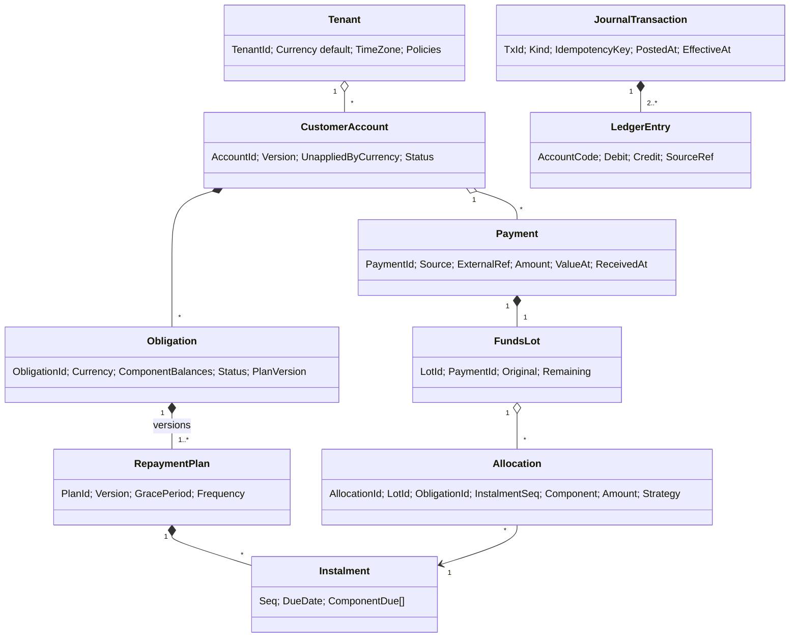
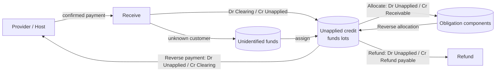
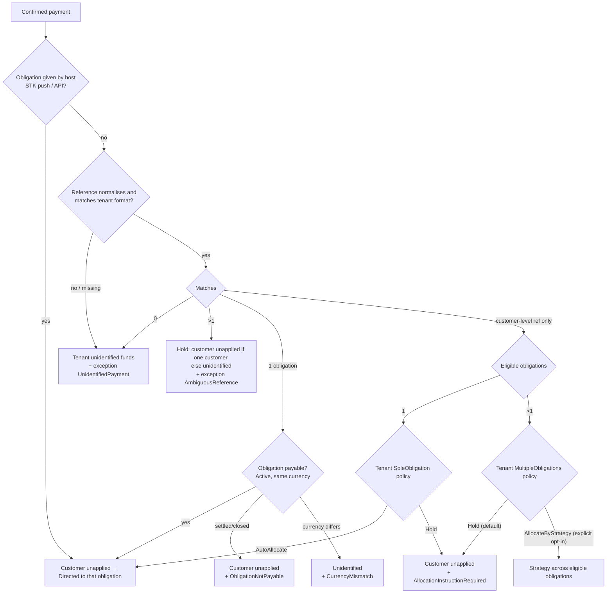
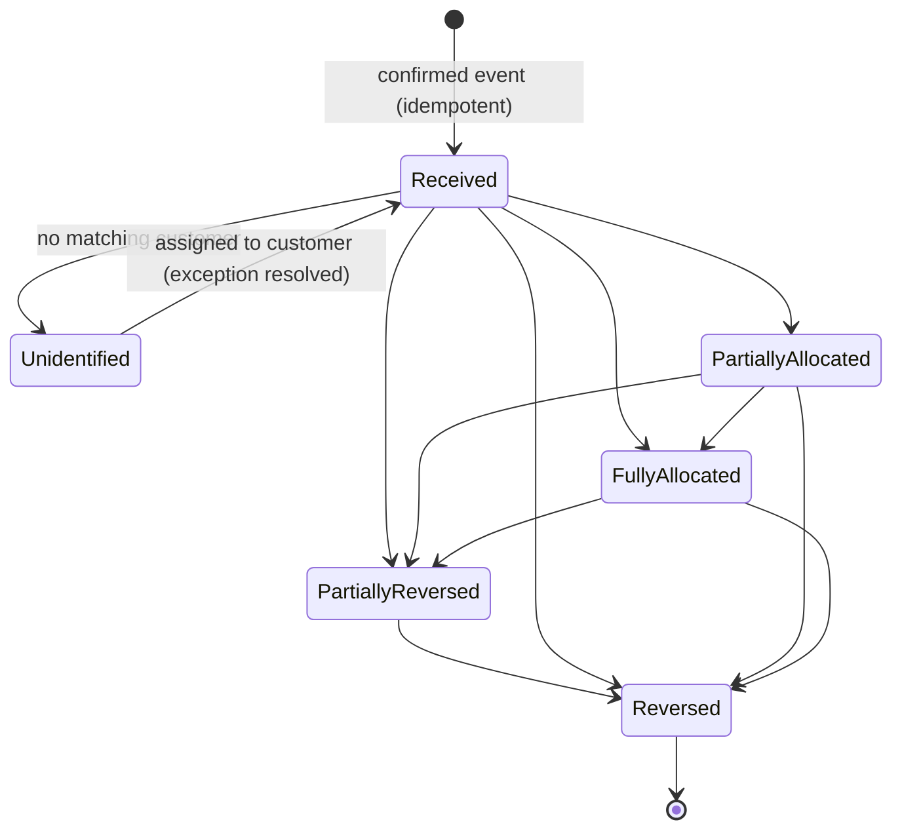
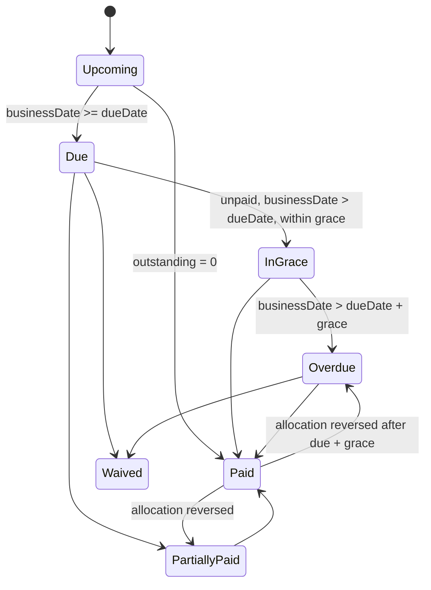

# Document 2 — Domain and Financial Model

## 1. Vocabulary (the distinctions that matter)

| Term | Definition | Mutable? | Example |
|---|---|---|---|
| **Tenant** | A lender (or other business) whose data is isolated from every other tenant. Every record belongs to exactly one tenant. Its configuration lives in a versioned **tenant policy** (ADR-007). | Policy versioned | "AcmeFinance-KE" |
| **Customer Account** | The party who owes and pays, inside one tenant. It holds unapplied credit and owns obligations. **It is the consistency boundary.** | Version increments | Customer `C-881` |
| **Obligation** | A contractual amount owed under one agreement (a loan or financing agreement in the host system), split into **components**: principal, interest, fee, penalty. It carries the host's external ID and a unique **payment reference**. | Balances change only through journal entries | Phone financing `LN-100001`, KES 15,000 |
| **Payment Reference** | A tenant-unique, format-validated identifier customers quote when paying (the paybill account number). It maps to exactly one obligation. | Immutable once used | `LN-100001` |
| **Repayment Plan** | The agreed timetable that breaks an obligation into instalments. It is versioned. In 1.0 a new version is allowed only before any financial history exists, or as part of cancellation (ADR-011). Restructuring comes later. | Immutable per version | 1 deposit + 270 daily instalments |
| **Instalment** | One scheduled entry in a plan: a due date and a due amount per component. Its *status is derived*, never stored as truth. | Immutable definition; derived state | #14, due 2026-12-02, KES 50 principal |
| **Payment (Receipt)** | A confirmed inbound money movement from an external source, identified by `(source, externalReference)`. | **Immutable**; reversed by a separate Reversal | M-Pesa `TJ3K9XYZ` KES 700 |
| **Funds Lot** | The portion of a payment's value currently held as credit. Allocations consume lots. It makes "where did this money go?" exact. | Remaining amount derived | Lot of `TJ3K9XYZ`: 700 → 200 left |
| **Allocation** | Application of an amount from **one lot** to **one instalment component** of one obligation. It records the strategy name and version. | **Immutable**; undone by an AllocationReversal | 50 → L-2041 #14 principal |
| **Unapplied Funds** | Confirmed funds belonging to a known customer that are not yet applied. It is a liability the business owes the customer. Equals the sum of remaining lot amounts. | Derived | KES 200 |
| **Unidentified Funds** (suspense) | Confirmed funds that cannot yet be attributed to any customer. They are held at tenant level. | Derived | Paybill receipt with an unknown account number |
| **Payment Exception** | A work item explaining why a recorded payment was not (fully) allocated: unidentified, ambiguous reference, allocation instruction required, obligation not payable, or currency mismatch. It is resolved by normal journal commands (ADR-009). | State machine | `AmbiguousReference` with 2 candidates |
| **Charge** | An increase to an obligation component posted **by the host** after origination: interest, fee or penalty. The engine never calculates it (ADR-008). | Immutable | Late fee KES 20 |
| **Waiver / Adjustment** | A decrease to an obligation component that does not come from customer funds. | Immutable | Waive penalty 20 |
| **Reversal** | Negation of all or part of a prior payment, allocation, charge or refund. It never edits the original. | Immutable | Reverse 500 of `TJ3K9XYZ` |
| **Refund** | Return of unapplied funds to the customer. It follows the lifecycle Requested → Confirmed or Failed. It is recorded only; the host executes the payout (ADR-010). | State machine | Refund KES 200 |
| **Journal Transaction** | A balanced set of **ledger entries** (debits = credits per currency), produced atomically by one command. | **Append-only** | `JT-…` for allocation |
| **Ledger Entry** | One debit or credit line on one ledger account, referencing its source document (payment, allocation, etc.). | **Append-only** | Cr `obl:L-2041:principal` 50 |

**The main point:** a payment is a fact about the outside world, an allocation is a decision we make about that money, an instalment is a promise in the contract, and the ledger is the record that ties them together.

## 2. Aggregates and consistency



**Aggregate decision (ADR-003):** `CustomerAccount` is the aggregate root for every money-moving command: receive, allocate, reverse, refund, charge, waive. Obligations are entities inside it.

- **Why:** one receipt may allocate across N obligations. Enforcing "Σ allocations ≤ funds" and "no over-settlement" requires one concurrency token covering the lots and all of the targets.
- **Cost:** commands for one customer serialise. This is acceptable because contention is per customer and low (a person rarely makes several payments in the same few milliseconds). Scenario 2 (two concurrent KES 400 payments) becomes *retry on version conflict*, which is correct by construction.
- **Loading:** the aggregate loads only *open* obligations, their open instalments and active lots, not history. Settled history stays in the journal.
- **Unidentified funds** sit in a system account per tenant and provider account (to avoid a single hot row), so they follow the same rules.
- **Tenant scope:** every aggregate load and save carries `TenantId`. An aggregate refuses to operate on a different tenant's entities (ADR-007).
- **Alternative rejected:** per-obligation aggregates with a saga for cross-obligation splits. That design is more complex, has intermediate inconsistent states, and has no real benefit at this scale.

## 3. Value objects

- `Money(decimal Amount, Currency Currency)`:
  - arithmetic only within the same currency;
  - throws on scale greater than `Currency.MinorUnits`;
  - `Allocate(ratios)` uses the largest-remainder method and is deterministic;
  - no implicit conversions.
- `Currency`: ISO 4217 code plus minor units. KES has 2 (ISO) even though M-Pesa transacts in whole shillings. The adapter validates this.
- `ExternalReference(string Source, string Value)`, for example `("mpesa:600123", "TJ3K9XYZ")`. Source includes the shortcode or till, because receipt numbers are unique per provider, not per business.
- `IdempotencyKey`: a caller-supplied string, ≤ 128 characters.
- `BusinessDate` (`DateOnly`) and instants (`DateTimeOffset`, UTC); `TenantClock` converts between them using the tenant's time zone. Provider local times (Daraja `TransTime` `YYYYMMDDHHmmss`, East Africa Time without an offset) are converted in the adapter, never in core.
- `ComponentType`: `Principal | Interest | Fee | Penalty`. This set is closed. Fees can carry a sub-code such as `"processing"` or `"insurance"`.
- `AllocationLine(LotId, ObligationId, InstalmentSeq?, ComponentType, Money)`.
- `StrategyRef(Name, Version)`.

## 4. Money flow: the two-step model



The rules that follow from this model:

- Allocation **only ever draws from unapplied credit.** "Allocations cannot exceed available funds" reduces to "lot remaining ≥ 0".
- An overpayment is the remainder that no strategy consumed.
- Customer-directed allocation is allocation of existing credit using the `Directed` strategy.
- Reversing a payment means: (1) unwind the allocations that consumed that payment's lot, most recent first, until enough is freed; (2) remove the freed amount from credit. Step (1) re-opens instalments automatically, because their status is derived.
- After a reversal, the remaining credit from *other* payments may be re-allocated. This is a tenant policy (`ReallocateAfterReversal`, default `true`) because it changes which receipts paid which instalments.

**Reversal deficit:** if a payment's credit has already gone out of the business (refunded), its value cannot be recovered from the lot. The shortfall is posted to `account:{id}:reversal-receivable`, a debit balance the customer owes. It is surfaced and never hidden. This is the only way an account goes "negative", and it always has its own ledger account.

## 4a. Payment identification (ADR-009)

Identification decides **where funds land** and **which obligations are eligible**. The allocation strategy then decides **how** funds spread within the eligible set. Recording the payment never depends on identification succeeding (ADR-002).



Rules:
- **A directed allocation never spills onto another loan.** Funds beyond what the target obligation can absorb (after the future-instalment policy has been applied) stay as customer unapplied funds.
- `IPaymentReferenceResolver` (host extension) may add matches, for example legacy references or customer-level references. It cannot bypass the ambiguity rule: more than one candidate always means an exception.
- An exception is resolved through `AssignToCustomer`, `AllocateToObligation`, `MarkForRefund` or `Dismiss` (Dismiss needs a reason and is only valid once the funds have been handled by another command). Each resolution is a journal command and is idempotent.

## 5. Ledger: chart of accounts and postings

These accounts are internal to the subledger, per tenant. Codes are hierarchical strings.

| Account | Normal side | Meaning |
|---|---|---|
| `clearing:{source}` | Debit (asset) | Funds held at the provider or bank (the M-Pesa paybill float, for example) |
| `unidentified:{source}` | Credit (liability) | Receipts not yet attributed to a customer |
| `acct:{acct}:unapplied:{ccy}` | Credit (liability) | Customer credit |
| `acct:{acct}:reversal-receivable:{ccy}` | Debit (asset) | Deficit from reversal after refund |
| `obl:{obl}:{component}` | Debit (asset) | Outstanding receivable per component |
| `origination:{component}` | Credit | The counterpart when an obligation is opened or a charge posted. The host's general ledger maps this to sales, loan principal, income or deferred income. |
| `waiver:{component}` | Debit | Write-down expense counterpart |
| `refund-payable:{acct}` | Credit | Refund requested, not yet executed |

| Command | Journal transaction |
|---|---|
| Open obligation 15,000 | Dr `obl:L:principal` 15,000 / Cr `origination:principal` 15,000 |
| Post fee 20 | Dr `obl:L:fee` 20 / Cr `origination:fee` 20 |
| Receive 700 | Dr `clearing:mpesa:600123` 700 / Cr `acct:C:unapplied:KES` 700 |
| Receive 300, reference unknown | Dr `clearing:mpesa:600123` 300 / Cr `unidentified:mpesa:600123` 300 |
| Assign unidentified 300 to customer | Dr `unidentified:mpesa:600123` 300 / Cr `acct:C:unapplied:KES` 300 |
| Post interest 500 (host-calculated) | Dr `obl:L:interest` 500 / Cr `origination:interest` 500 |
| Cancel obligation, write off 2,000 principal | Dr `waiver:principal` 2,000 / Cr `obl:L:principal` 2,000 (reason code required) |
| Allocate 500 | Dr `acct:C:unapplied` 500 / Cr `obl:L:principal` 500 (one line per component and instalment) |
| Reverse allocation 500 | Dr `obl:L:principal` 500 / Cr `acct:C:unapplied` 500 |
| Reverse payment 700 | Dr `acct:C:unapplied` 700 / Cr `clearing:…` 700 |
| Waive penalty 20 | Dr `waiver:penalty` 20 / Cr `obl:L:penalty` 20 |
| Request refund 200 | Dr `acct:C:unapplied` 200 / Cr `refund-payable:C` 200 |
| Refund confirmed | Dr `refund-payable:C` 200 / Cr `clearing:…` 200 |
| Refund failed | Dr `refund-payable:C` 200 / Cr `acct:C:unapplied` 200 |

**Per-instalment detail:** obligation receivable accounts hold the component total. Instalment-level allocation is stored as allocation rows that reference the journal transaction. This avoids an explosion of ledger accounts (365 instalments × 4 components). Instalment balances are derived as `due − Σ active allocations − Σ waivers on that instalment`.

**Journal export:** `IJournalExporter` streams `(TxId, EffectiveDate, Lines[account, dr, cr, sourceRef])` for the host's general ledger, with a cursor (high-water mark) so the export is exactly-once on the consumer side.

## 6. State machines

### 6.1 Payment



The allocation status is *derived* from lot remaining. Only `Unidentified` and the reversal totals are recorded facts. **Pending payments** (an STK push initiated but not yet confirmed) are not Payments in core. They live in the payments package as `PaymentIntent` and only become a Payment when confirmed.

### 6.2 Payment intent (payments package)

`Created → Submitted → (Confirmed | Failed | Ambiguous → Confirmed | Failed | Expired)`.

`Ambiguous` covers an STK timeout, Airtel status `TA`, or an HTTP timeout on initiation. Ambiguous intents are resolved only by a status query or reconciliation, **never by assumption**.

### 6.3 Instalment (derived)



The status is a pure function `f(instalment, allocations, waivers, asOfDate, grace)`, so there are no stale flags. Each instalment also records `SettledAt`, the effective time of the allocation that brought outstanding to 0. That feeds on-time versus late analytics and clears again if that allocation is reversed.

### 6.4 Obligation

`Active → Settled` (all components 0) `→ Active` (if a reversal re-opens it). Other transitions:
- `Active → Closed` (written off or cancelled by a host command with reason).
- `Settled → Closed` after a configurable cooling period. This guards against late reversals.

### 6.5 Payment exception

`Open → Resolved | Dismissed`. Ageing is tracked from `opened_at`. A resolved exception links to the journal transaction that resolved it. Re-opening is impossible; a wrong resolution is corrected by compensating commands plus a new exception if needed.

### 6.6 Repayment plan version (ADR-011)

`Active → Superseded` (only if no allocation or waiver ever targeted it) `| Cancelled` (together with obligation cancellation). Exactly one Active version per obligation, except after cancellation when there are none.

### 6.7 Refund

`Requested → Confirmed | Failed`. A failed refund returns the credit.

## 7. Financial invariants

Each invariant is enforced in code (E), backed by a database constraint (D), and verified by the `Verify` routine or a test (V).

| # | Invariant | Enforcement |
|---|---|---|
| I-1 | Every journal transaction balances per currency: Σdr = Σcr | E, D (deferred constraint trigger), V |
| I-2 | Journal transactions and entries, payments, allocations and reversals are never updated or deleted | E (no API), D (trigger rejects UPDATE/DELETE; role permissions), V |
| I-3 | A payment `(tenant, source, externalRef)` is recorded at most once | D unique index, E |
| I-4 | Re-submitting a command with the same idempotency key returns the original result. The same key with a different payload hash is rejected. | D unique `(tenant, key)`, E |
| I-5 | Lot remaining ≥ 0, and Σ active allocations from a lot + remaining + reversed + refunded = original | E, V |
| I-6 | Component outstanding ≥ 0. Instalment component outstanding ≥ 0. No allocation over-settles. | E, V; D check on projection |
| I-7 | Allocations come only from confirmed funds in the **same currency and tenant** | E (type system plus checks) |
| I-8 | Σ reversals of a payment ≤ payment amount | E, D check on projection, V |
| I-9 | A reversal restores exactly what it unwinds: after full reversal of payment P, every instalment's outstanding equals its value had P never existed (apart from re-allocation of other credit) | Property test V |
| I-10 | Projected balances = fold(journal) at every committed state | V (`Verify`), nightly in CI against generated histories |
| I-11 | Unapplied credit ≥ 0. Deficit exists only in `reversal-receivable`. | E, V |
| I-12 | An obligation is Settled ⇔ all of its component outstanding amounts = 0 | E (derived), V |
| I-13 | The schedule total per component = the obligation's originated amount per component (when the plan is created or versioned) | E |
| I-14 | Allocation is deterministic: the same snapshot, amount and strategy version give an identical plan | Property test |
| I-15 | Every ledger entry references a source document, and every movement has a source and destination account | D NOT NULL, E |
| I-16 | Money scale ≤ the currency's minor units, and amounts are > 0 on all commands | E |
| I-17 | Conservation per tenant: Σ clearing debits − Σ clearing credits = Σ unapplied + Σ unidentified + Σ settled receivables + Σ refund-payable − Σ reversal-receivable | V |
| I-18 | **Tenant isolation:** no record references another tenant's record, and no command or query reads or affects another tenant's data | D (composite FKs, row-level security), E, cross-tenant tests |
| I-19 | **No payment is lost:** every authenticated, well-formed confirmed payment is recorded, whatever the identification outcome | E, property test over identification outcomes |
| I-20 | **No silent ambiguity:** a payment with zero or several candidate obligations is never allocated without an explicit resolution or an explicit tenant opt-in policy | E, property test |
| I-21 | A directed allocation only targets the directed obligation. Leftover funds stay unapplied. | E, V |
| I-22 | Every lot with remaining funds in unidentified funds has an open payment exception | V |
| I-23 | A superseded plan version has no allocations or waivers. Every allocation references the plan version it targeted. | E, D (FK), V |

## 8. Domain events (emitted through the outbox)

- `ObligationOpened`
- `ChargePosted`
- `PaymentReceived`
- `PaymentUnidentified`
- `PaymentExceptionRaised`, `PaymentExceptionResolved`
- `PlanSuperseded`, `ObligationCancelled`
- `PaymentAssigned`
- `FundsAllocated` (with lines)
- `InstalmentSettled`
- `InstalmentReopened`
- `ObligationSettled`
- `ObligationReopened`
- `PaymentReversed` (partial or full)
- `AllocationReversed`
- `CreditRefundRequested`, `CreditRefundConfirmed`, `CreditRefundFailed`
- `AmountWaived`
- `ReversalDeficitRecorded`
- `PaidThroughDateChanged` (PAYG device unlock/lock hook)

Events carry `TenantId`, `AccountId`, `AccountVersion` (for consumer ordering per account), `JournalTxId`, `OccurredAt` and `EffectiveAt`. Consumers must be idempotent on `EventId`, because delivery is at-least-once.

## 9. Allocation model

```
AllocationContext  = { Account snapshot (open obligations, instalments, component outstanding), Lots (FIFO), Amount, AsOf, Directive? }
IAllocationStrategy.Plan(ctx) -> AllocationPlan { Lines[], Unallocated, StrategyRef }
```

The engine **validates every plan** before applying it, so a buggy custom strategy cannot break an invariant:
- lines reference open targets;
- Σ lines ≤ amount;
- no target goes below 0;
- currency matches;
- lines are positive.

### Built-in strategies, as compositions of three orderings plus one policy

| Strategy | Obligation order | Instalment order | Component order |
|---|---|---|---|
| `OldestDueFirst` (default) | by oldest unpaid due date across obligations | ascending due date | per tenant (default penalty→fee→interest→principal within each instalment) |
| `CurrentDueFirst` | current-due first, then arrears oldest-first | current, then arrears | same as above |
| `PrincipalFirst` | configurable | ascending | principal→interest→fee→penalty |
| `ChargesFirst` | configurable | ascending | penalty→fee→interest→principal |
| `Proportional` | split by outstanding ratio (largest remainder) | ascending within each | configurable |
| `Directed` | as specified by `AllocationDirective` (obligation, optionally instalment or component); a remainder falls back to the default strategy or is held as credit | — | — |

**Future-instalment policy** (when no instalment is due yet):
- `HoldAsCredit`, the default and the safest legally;
- `ApplyToNextInstalments`, needed for PAYG paid-through;
- `PrepayPrincipal`, which reduces the principal on the last instalments first (needed for early settlement).

**Eligibility comes first:** strategies receive only the obligations that identification permits (§4a). For a directed payment that is a single obligation. `OldestDueFirst` across obligations only applies when the tenant has opted in to `MultipleObligations = AllocateByStrategy`, or when ops run an explicit allocation of a customer's unapplied funds across obligations.

**Fairness and determinism:** ties are broken by `(DueDate, ObligationOpenedAt, ObligationId, InstalmentSeq)`. Lots are consumed FIFO by `(ValueAt, PaymentId)`.

**Back-dated payments** (value time earlier than allocations already made, for example a delayed callback): in the MVP, allocation uses *processing order*, and the value date is recorded and used for on-time and arrears reporting. Fineract-style *reverse-replay* (re-ordering history by value date) is a 1.x opt-in, because it rewrites which payment paid what. It is done with compensating entries, never by editing.

## 10. Paid-through date (PAYG)

For a plan with frequency *f* and per-period amount *a*:

- `PaidThroughDate` = the due date of the last instalment that is fully paid, contiguous from the first one, **plus** the coverage bought by a partial payment on the next instalment, if the tenant enables pro-rata days.
- `DaysAhead`/`DaysBehind` = the difference from today.

It is recomputed after every allocation or reversal. `PaidThroughDateChanged` is emitted so device-lock services can react.
