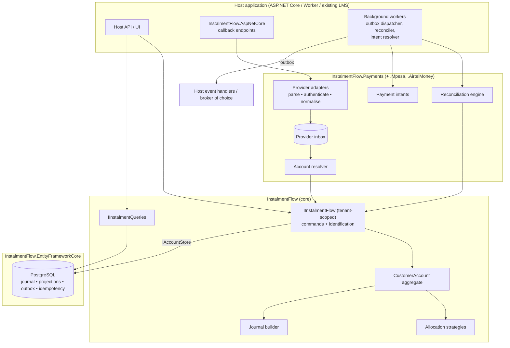
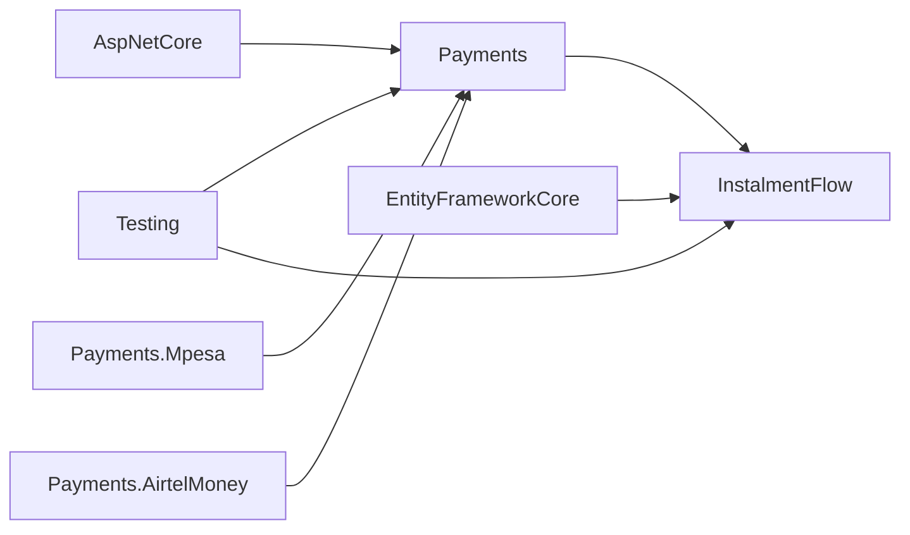
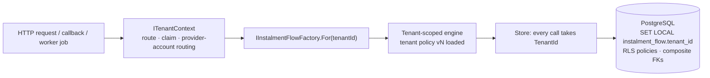
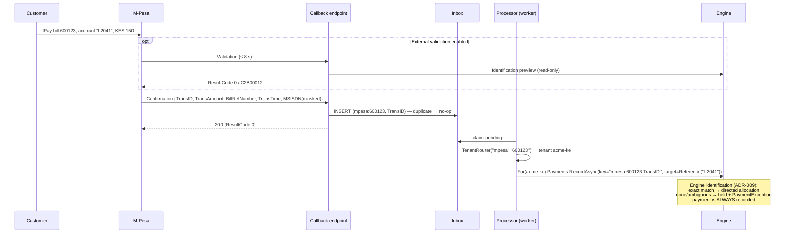
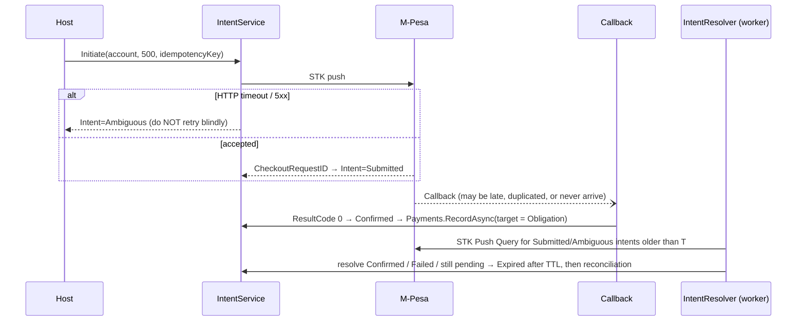

# Document 3 — Architecture Design

## 1. Architectural style

- **An embeddable library.** It is not a service and has no microservices. The host application owns the process, database and transactions. InstalmentFlow runs inside it.
- **Hexagonal, kept light:**
  - the domain plus application services sit in core;
  - persistence and the clock are ports;
  - provider adapters translate outside events into core commands.
  - There are no repository-per-entity layers, no MediatR, and no AutoMapper. MediatR and AutoMapper moved to commercial licensing in 2025, and MassTransit v9 is commercial. Avoiding them also keeps the core free of dependencies.
- **CQRS, kept light:** commands go through the aggregate. Queries read projections or journal tables directly through `IInstalmentQueries`. There is no separate read database.
- **Deployable reference host (optional, post-MVP):** a sample `InstalmentFlow.Server` container showing ASP.NET Core with callbacks, PostgreSQL and a worker in **one process** (a modular monolith). Splitting it up is possible but never required.

## 2. High-level view



## 3. Packages

| Package | Contents | Depends on |
|---|---|---|
| **`InstalmentFlow`** (core) | `Money` and `Currency`; domain model; **tenant policy and tenant-scoped engine factory**; **payment identification and the payment exception queue** (`IPaymentReferenceResolver`); allocation strategies; journal builder; `IInstalmentFlow` facade; queries; `Verify`; ports (`IAccountStore`, `IIdempotencyStore`, `IJournalReader`, `IOutbox`, `ITenantPolicyStore`); in-memory store; DI extensions; `ActivitySource` and `Meter` | BCL, `Microsoft.Extensions.*.Abstractions` only |
| **`InstalmentFlow.EntityFrameworkCore`** | EF Core mappings; `IAccountStore` with optimistic concurrency; outbox table and dispatcher `BackgroundService`; migrations; append-only triggers and **row-level security policies** (PostgreSQL); tenant session setting per transaction; `Verify` SQL | core, EF Core 10, Npgsql provider 10 (PostgreSQL is the only supported provider in v1) |
| **`InstalmentFlow.Payments`** | `IPaymentProviderAdapter` SPI; `NormalisedPaymentEvent`; provider inbox; **tenant routing** (`ITenantRouter`: provider account → tenant); `PaymentIntent` state machine; reconciliation engine and statement importer contracts; **simulated provider** with fault injection (ADR-016) | core |
| **`InstalmentFlow.Payments.Mpesa`** | Daraja client (OAuth, STK push and query, C2B register/validation/confirmation, Transaction Status, Pull Transactions, statement CSV import; parsing of reversal results and statement lines, but **no reversal or B2C initiation in 1.0** (ADR-010)); payload models; SecurityCredential encryption; adapter | Payments, `System.Net.Http` |
| **`InstalmentFlow.Payments.AirtelMoney`** | Airtel Open API client (OAuth, USSD push collection, enquiry; **no refund or disbursement initiation in 1.0**); callback parsing and optional authenticated-callback verification; adapter | Payments |
| **`InstalmentFlow.AspNetCore`** | `MapInstalmentFlowCallbacks()` minimal-API endpoints; `ITenantContext` per request (from route, claim or provider account); IP allowlist and secret-path filters; simulator endpoints (refused in `Production` by default); health checks; `ProblemDetails` mapping | Payments, ASP.NET Core shared framework |
| **`InstalmentFlow.Testing`** | `FakeTenantClock`; a scenario DSL (`Given.Account().WithObligation(...).When.Pays(100)...`); provider payload builders and simulators; invariant assertion helpers for host test suites | core, Payments |

**Changes from the proposed structure, and why:**
- `Allocation` and `Ledger` are merged into core. They have no standalone use, and keeping them separate would force lock-step versioning anyway.
- `Persistence.Abstractions` is merged into core. The ports have to live where the aggregate lives.
- `Messaging.Abstractions` is dropped. The outbox dispatcher calls `IIntegrationEventPublisher`, which the host implements (with Wolverine, MassTransit v8, Azure Service Bus, or a direct handler). A broker adapter can be added later as a separate package if someone asks for one.
- `Payments.Abstractions` is renamed `Payments`, because it contains real behaviour (inbox, intents, reconciliation), not just interfaces.
- `Testing` is added. Shipping test helpers is a large developer-experience win for a correctness-focused library.

### Repository layout

```
instalment-flow/
  src/
    InstalmentFlow/
    InstalmentFlow.EntityFrameworkCore/
    InstalmentFlow.Payments/
    InstalmentFlow.Payments.Mpesa/
    InstalmentFlow.Payments.AirtelMoney/
    InstalmentFlow.AspNetCore/
    InstalmentFlow.Testing/
  tests/
    InstalmentFlow.Tests/                     # unit + property-based (CsCheck) + scenario specs
    InstalmentFlow.EntityFrameworkCore.Tests/ # Testcontainers PostgreSQL: integration, concurrency, failure injection
    InstalmentFlow.Payments.Tests/            # inbox, intents, reconciliation
    InstalmentFlow.Payments.Mpesa.Tests/      # contract tests (recorded payloads, WireMock.Net)
    InstalmentFlow.Payments.AirtelMoney.Tests/
    InstalmentFlow.AspNetCore.Tests/          # WebApplicationFactory end-to-end
    InstalmentFlow.ArchitectureTests/         # ADR-013 boundaries, zero-dependency core, no floating point (exists since M0)
  benchmarks/InstalmentFlow.Benchmarks/       # BenchmarkDotNet
  load/                                       # k6 scripts against samples/ReferenceHost
  samples/
    01-ConsoleQuickstart/          # in-memory, 30 lines
    02-PaygPhoneFinancing/         # daily micro-payments, paid-through date
    03-MultipleLoans/              # allocation across obligations
    04-AspNetCoreMpesa/            # PostgreSQL + Daraja sandbox + callbacks
    05-ExistingLmsIntegration/     # engine inside an existing DbContext
  docs/  (architecture, decisions/ADR-NNN, allocation-strategies, financial-invariants,
          failure-scenarios, integrations/mpesa, integrations/airtel, planning/)
  Directory.Build.props  Directory.Packages.props  global.json  .editorconfig
```

Property tests live inside each test project rather than in a separate `PropertyBasedTests` project. Concurrency tests need a real database, so they live in the EF tests. Organising by test type would scatter tests for a single feature across projects.

## 4. Dependency rules (enforced by architecture tests)



- Core references nothing outside the BCL and `Microsoft.Extensions.*.Abstractions`.
- No package references a provider package except samples.
- EF and Payments do not reference each other. The Payments inbox and intents use **their own port** (`IPaymentsStore`), and the EF package implements it via an optional `UsePaymentsStore()` call. *Decision point:* this means the EF package does take a reference to Payments. The alternative is `InstalmentFlow.Payments.EntityFrameworkCore`. **Recommendation:** EF references Payments (it is small), to avoid an extra package.

## 5. Command processing and transactions

```mermaid
sequenceDiagram
    participant H as Host/Adapter
    participant E as Engine
    participant I as IdempotencyStore
    participant S as AccountStore
    participant A as CustomerAccount
    participant DB as PostgreSQL

    H->>E: Payments.RecordAsync(key, source, amount, target)
    E->>I: TryGet(key)
    alt seen before
        I-->>E: stored result (hash matches) → return Duplicate
    end
    loop up to N retries on ConcurrencyConflict
        E->>S: Load(account) [open obligations, lots, version v]
        E->>A: Record(...) → Identify → Allocate(strategy, eligible set)
        A-->>E: Changes {journal tx, payment, lot, allocations, projections, events}
        E->>S: Save(changes, expectedVersion v)
        S->>DB: BEGIN; INSERT payment (unique ref); INSERT journal; INSERT allocations;<br/>UPDATE projections; INSERT outbox; INSERT idempotency;<br/>UPDATE account SET version=v+1 WHERE version=v; COMMIT
    end
    E-->>H: Result {paymentId, allocations, unapplied, settled instalments}
```

- **One command = one database transaction = one journal transaction.** Isolation is `READ COMMITTED` plus optimistic concurrency on the account row. If the version update affects 0 rows, the store throws `ConcurrencyConflict`, the engine reloads and retries (default 5 attempts with jittered back-off), then surfaces the error.
- **Duplicate detection does not rely only on the idempotency table.** The unique index on `(tenant, source, external_ref)` is the last line of defence, for the case where two concurrent duplicate callbacks both miss the idempotency check. The losing transaction gets a unique-violation error, which is mapped to `Duplicate`.
- **Host-owned transactions:** for LMS integration (sample 05), the host can pass its own `DbContext` or `DbTransaction`, so obligation creation commits atomically with the host's loan record.
- **The in-memory store** uses a per-account `SemaphoreSlim` and version checks, so the same concurrency semantics can be tested without a database.

## 5a. Tenancy (ADR-007)



There are four layers of isolation, and any one of them stops a cross-tenant leak:
1. **API:** there is no tenant-less engine instance.
2. **Ports:** `TenantId` is a required parameter.
3. **EF:** global query filters.
4. **PostgreSQL:** row-level security plus composite foreign keys.

Background workers (outbox, inbox, intents, reconciliation) process rows tenant by tenant, and set the tenant session variable per transaction. A test suite runs every public command and query with mismatched tenant IDs and expects `IF5001 TenantMismatch` or "not found".

**Per-tenant policy** (versioned; each allocation stores the policy version it used):
- currency and time zone;
- allocation strategy@version and component order;
- future-instalment policy;
- grace default;
- charge due policy;
- payment reference format (regex plus normaliser);
- `SoleObligation` and `MultipleObligations` policies (ADR-009);
- `ReallocateAfterReversal`;
- provider accounts.

Provider credentials are fetched per tenant from the host through `IProviderCredentialSource`, and are never stored by the library.

## 6. Event processing

### Outbox (outbound)
- Events are written to `outbox` in the same transaction as the journal.
- The `OutboxDispatcher` (a `BackgroundService`) claims batches with `FOR UPDATE SKIP LOCKED` and calls `IIntegrationEventPublisher`. It marks rows dispatched, and retries with exponential back-off and a dead-letter state after N attempts.
- Ordering is guaranteed **per account** (dispatch ordered by `(account_id, account_version)`, and a batch never parallelises within one account). There is no global ordering.
- Delivery is at-least-once, so consumers deduplicate by `event_id`.

### Inbox (inbound, payments package)
- Every raw provider message is stored **before** processing:
  - `provider_inbox(provider, dedupe_key, raw_payload, headers_subset, received_at, status)`;
  - unique on `(provider, dedupe_key)`, where the dedupe key is e.g. the M-Pesa `TransID` or Airtel `transaction.id`.
- Processing then normalises the message and calls the engine with an idempotency key derived from the dedupe key.
- The HTTP handler returns success to the provider **after the inbox insert commits**, not after allocation. This keeps provider-facing latency low and lets processing be retried.
- *Exception:* C2B **validation** must answer synchronously within about 8 s. It runs only a read-only reference check (does `BillRefNumber` identify a payable obligation?), with no money movement. Rejecting at validation is a tenant option. The default accepts, because a recorded unidentified payment is better than refused money (ADR-002).

## 7. Payment provider integration

### 7.1 Adapter contract

```csharp
public interface IPaymentProviderAdapter
{
    string Provider { get; }                                   // "mpesa", "airtel"
    ProviderCapabilities Capabilities { get; }
    ValueTask<CallbackParseResult> ParseCallbackAsync(ProviderCallback raw, CancellationToken ct);  // authenticate + normalise
}
public interface ICollectionInitiator   { Task<InitiationResult> InitiateAsync(CollectionRequest r, CancellationToken ct); }
public interface ITransactionStatusQuery{ Task<StatusQueryResult> QueryAsync(ProviderTransactionRef r, CancellationToken ct); }
public interface IStatementSource       { IAsyncEnumerable<StatementLine> ReadAsync(DateTimeOffset from, DateTimeOffset to, CancellationToken ct); }
// IRefundInitiator / IReversalInitiator: designed for 1.1, not shipped in 1.0 (ADR-010)
```

Adapters implement only the interfaces their provider actually supports. `ProviderCapabilities` is a flags enum that documentation and validation use. For example, configuring a status-polling resolver for a provider without status queries fails at startup.

### 7.2 Capability matrix

> M11 rechecked the Airtel column: see [docs/integrations/airtel.md](../integrations/airtel.md). Its callbacks carry no amount and are not known to be signed, so the inbox confirms each with an enquiry.
>
> M9 rechecked the M-Pesa column: see [docs/integrations/mpesa.md](../integrations/mpesa.md) for the current status of each item. Among the differences: a recent source reports that C2B v2 sends a hashed, not masked, MSISDN in production; and the STK query returns no receipt.

*Verified* means confirmed against a mirror of Safaricom's Daraja v3 documentation or multiple independent sources. *Verify* means it must be confirmed against the official portal and with the provider's account team before implementation. Each adapter milestone starts with a **verification spike**.

| Capability | M-Pesa (Daraja) | Airtel Money (Open API) |
|---|---|---|
| Auth | OAuth client-credentials, token valid ~1 h — *verified* | OAuth2 `POST /auth/oauth2/token`, `client_credentials`, `expires_in` 3600 — *verified (community)* |
| Merchant-initiated collection | M-Pesa Express (STK push) `/mpesa/stkpush/v1/processrequest`, result to a per-request `CallBackURL` — *verify version* | USSD push `POST /merchant/v2/payments/` with `X-Country`/`X-Currency` headers — *verify version (v1 vs v2)* |
| Customer-initiated (paybill/till) notification | C2B `/mpesa/c2b/v2/registerurl`; Confirmation and optional Validation URLs — *verified* | **Unknown.** Open API docs focus on push collection. Whether till/paybill payments notify via API in Kenya — *verify with Airtel KE* |
| Validation hook | Only if External Validation is enabled on the shortcode (by email request). Respond within ~8 s. `ResponseType` Completed/Cancelled sets the fallback — *verified* | None known |
| Callback authenticity | **No signature documented.** Rely on TLS, a source-IP allowlist (Safaricom-published ranges, *verify current list*), an unguessable path secret, and reconciliation | Optional *authenticated callback*, enabled in the portal; mechanism to be confirmed — *verify* |
| Callback destination | Per request (STK) or registered once per shortcode (C2B; production changes need deletion and re-registration) | Configured in the developer portal (not per request) — *verify* |
| Callback retry behaviour | Not documented. Treat as at-most-once with possible duplicates. | Not documented — *verify* |
| Payer identity in notification | C2B v2 MSISDN is **masked** (`2547 ***** 126`), with first and last name fields — *verified* | MSISDN as submitted |
| Status query | STK Push Query (`/mpesa/stkpushquery/v1/query`); Transaction Status `/mpesa/transactionstatus/v1/query` is **async** (ResultURL/QueueTimeOutURL), needs Initiator + SecurityCredential — *verified* | `GET /standard/v1/payments/{id}`, statuses TS/TF/TA/TIP — *verified (community)* |
| Bulk reconciliation | Pull Transactions API: register once; query C2B only, **last 48 h**, paginated by offset — *verified*. Plus org portal statement export (CSV) | Statement export — *verify* |
| Reversal (capability noted; **not used in 1.0**, ADR-010) | Reversal API `/mpesa/reversal/v1/request`, **business-initiated, C2B only**, async result; codes e.g. `R000001` already reversed. Partial amounts not documented — *verify* | Refund by `airtel_money_id`; community SDKs claim full or partial — *verify* |
| Refund to customer | Reversal (C2B), or a B2C payment (separate product approval) | Refund API, or disbursement (PIN encrypted) — *verify* |
| Amount precision | Whole KES in practice. Adapter rejects or flags fractional amounts. | Per currency — *verify* |

### 7.3 Key flows

**C2B paybill payment (the most common PAYG flow):**



**STK push with timeout and ambiguity:**



The rule for the timeout case: **a timeout is not a failure.** An intent in `Ambiguous` or `Submitted` blocks a re-initiation with the same idempotency key. The host's UI should say "checking…", not "failed, try again". Otherwise customers pay twice. If they pay twice anyway, the second payment becomes unapplied credit, which is still correct.

**Reconciliation:**
1. `IStatementSource` (Pull Transactions, or an imported CSV statement) yields provider lines.
2. Each line is matched to inbox rows and payments by `(source, externalRef)`.
3. The result is classified:
   - `Matched`;
   - `MissingInEngine`, auto-ingested through the normal inbox path (idempotent);
   - `MissingAtProvider`, raised as a discrepancy and never auto-reversed;
   - `AmountMismatch`, raised as a discrepancy;
   - `ReversedAtProvider`, which creates a `ReversePayment` command when the tenant policy is `AutoReverse`, otherwise a discrepancy.
4. Each run is recorded with a cursor and a report.

### 7.4 Security

- Credentials come through `IOptions` and are never logged. A redaction policy applies to payloads (MSISDN, names).
- Raw inbox payloads are encrypted at rest *optionally* via an `IPayloadProtector` hook (Data Protection API), and kept for a configurable retention period. This is part of the Kenya Data Protection Act 2019 consideration (doc 07).
- Callback endpoints use:
  - a path secret;
  - an optional IP allowlist;
  - a request size limit;
  - no redirects;
  - a constant-time comparison for any shared secret.
- M-Pesa `SecurityCredential` is RSA-encrypted with Safaricom's public certificate. The certificate is configurable (sandbox and production differ).

## 8. Observability

- `ActivitySource("InstalmentFlow")` spans: `engine.receive`, `engine.allocate`, `store.save`, `outbox.dispatch`, `provider.callback`, `provider.status_query`, `reconcile.run`.
- `Meter("InstalmentFlow")` metrics:
  - `if.payments.received` (by provider and outcome: new, duplicate, unidentified, exception);
  - `if.exceptions.open` (by reason, with age);
  - `if.allocations.amount`;
  - `if.concurrency.retries`;
  - `if.outbox.lag_seconds`;
  - `if.intents.ambiguous`;
  - `if.reconciliation.discrepancies`;
  - `if.verify.violations` (alert on > 0).
- Structured logging through `ILogger` with source-generated `LoggerMessage` methods. Correlation fields: `tenant`, `account`, `journalTx`, `externalRef`.

## 9. Technology choices

| Concern | Choice | Reason |
|---|---|---|
| Runtime | `net10.0` (LTS, supported until 2028-11-14); CI also runs on .NET 11 | .NET 8 is EOL as of 2026-11-10 |
| ORM | EF Core 10 + Npgsql 10; raw SQL for hot paths and append-only triggers | Mainstream, and supports host `DbContext` integration |
| Time | `TimeProvider` (BCL) plus `DateOnly`, with a time-zone ID per tenant | Avoids a NodaTime dependency in core. A NodaTime bridge can be added if requested. |
| Tests | xUnit v3 on Microsoft Testing Platform (opted in via `global.json`, required by xunit.v3 4.x on the .NET 10 SDK), CsCheck (property-based and parallel linearizability checks), Testcontainers, WireMock.Net, Verify (snapshots) | CsCheck's `SampleParallel` gives model-based concurrency testing |
| Benchmarks / load | BenchmarkDotNet; k6 against the reference host | Both open source |
| Resilience | `Microsoft.Extensions.Http.Resilience` in provider clients only | Standard, and Polly v8 underneath |
| Analyzers | Nullable enabled, warnings as errors, `PublicApiAnalyzers`, `BannedApiAnalyzers` (ban `double`/`float` in Money paths, `DateTime.Now`) | Enforces the non-functional requirements mechanically |
