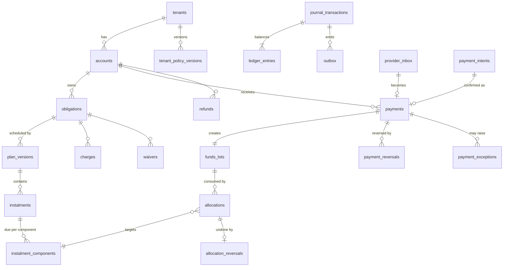

# Document 5 — Database Design (PostgreSQL reference)

## 1. Principles

- **Two kinds of table:**
  - **Facts** (append-only): journal, payments, allocations, reversals, charges, waivers, inbox. These are never updated or deleted. Triggers enforce this, and the application role has no UPDATE or DELETE grant.
  - **Projections** (mutable, derived): balances, versions, lot remaining. Every projection can be rebuilt from facts (`Verify` / `Rebuild`).
- **IDs** are UUIDv7 (`Guid.CreateVersion7()`), which are time-ordered and index-friendly. External references are stored separately and uniquely constrained.
- **Money** is stored as `numeric(19,4)` plus a `currency char(3)` column. Scale is validated against the currency's minor units in the application, and a check constraint enforces `amount > 0` on facts. Finance staff can query this directly. Floating-point types are never used.
- **Time:**
  - `timestamptz` for instants: `value_at` is when the provider says the money moved, and `recorded_at` is when we committed it;
  - `date` for business dates (`due_date`, `effective_date`).
- **Every table carries `tenant_id`.** Every primary key and **every foreign key is composite with `tenant_id` first**, so a row physically cannot reference another tenant's row. Row-level security is enabled on every table (§4a).
- **Schema:** `instalment_flow` (configurable), so the tables can sit inside a host database next to its own tables.

## 2. Entity-relationship overview



## 3. Tables (abridged DDL)

```sql
-- ===== Configuration =====
create table tenants (
  tenant_id        text primary key,
  base_currency  char(3) not null,
  time_zone      text not null,              -- IANA, e.g. Africa/Nairobi
  current_policy_version int not null,
  created_at     timestamptz not null default now()
);

create table tenant_policy_versions (        -- append-only; ADR-007
  tenant_id text references tenants, version int,
  policy jsonb not null,                     -- strategy@version, component order, future-instalment, grace,
                                             -- charge-due, reference format, Sole/MultipleObligations, flags
  created_at timestamptz not null, created_by text not null,
  primary key (tenant_id, version)
);

create table tenant_provider_accounts (     -- inbound routing: provider account → exactly one tenant
  provider text, provider_account text,      -- ('mpesa','600123'), ('airtel','MERCHANT42')
  tenant_id text not null references tenants,
  primary key (provider, provider_account)
);

-- ===== Aggregate root + projections =====
create table accounts (
  tenant_id        text not null references tenants,
  account_id     uuid not null,
  external_id    text not null,              -- host's customer id
  status         smallint not null,
  version        bigint not null default 0,  -- optimistic concurrency token
  created_at     timestamptz not null,
  primary key (tenant_id, account_id),
  unique (tenant_id, external_id)
);

create table account_balances (              -- projection, one row per currency
  tenant_id text, account_id uuid, currency char(3),
  unapplied            numeric(19,4) not null default 0 check (unapplied >= 0),          -- I-11
  reversal_receivable  numeric(19,4) not null default 0 check (reversal_receivable >= 0),
  primary key (tenant_id, account_id, currency)
);

create table obligations (
  tenant_id text, obligation_id uuid, account_id uuid not null,
  external_id text not null, payment_reference text not null, currency char(3) not null,
  status smallint not null, current_plan_version int,          -- null after cancellation
  opened_at timestamptz not null, settled_at timestamptz, closed_at timestamptz,
  close_reason text,
  primary key (tenant_id, obligation_id), unique (tenant_id, external_id),
  unique (tenant_id, payment_reference),                       -- ADR-009: normalised form stored
  foreign key (tenant_id, account_id) references accounts
);

create table obligation_component_balances ( -- projection
  tenant_id text, obligation_id uuid, component smallint, fee_code text not null default '',
  originated numeric(19,4) not null, charged numeric(19,4) not null default 0,
  allocated  numeric(19,4) not null default 0, waived numeric(19,4) not null default 0,
  outstanding numeric(19,4) generated always as (originated + charged - allocated - waived) stored,
  check (originated + charged - allocated - waived >= 0),                                   -- I-6
  primary key (tenant_id, obligation_id, component, fee_code)
);

-- ===== Schedule (immutable per version) =====
create table plan_versions (
  tenant_id text, obligation_id uuid, version int,
  frequency text not null, grace_days int not null, generator text not null, parameters jsonb not null,
  status smallint not null,                                            -- Active | Superseded | Cancelled
  created_at timestamptz not null, ended_at timestamptz,               -- status/ended_at: set once, by trigger-checked transition
  primary key (tenant_id, obligation_id, version)
);

create table instalments (
  tenant_id text, obligation_id uuid, plan_version int, seq int,
  due_date date not null,
  primary key (tenant_id, obligation_id, plan_version, seq)
);

create table instalment_components (
  tenant_id text, obligation_id uuid, plan_version int, seq int, component smallint, fee_code text not null default '',
  due numeric(19,4) not null check (due >= 0),
  allocated numeric(19,4) not null default 0,  -- projection columns
  waived numeric(19,4) not null default 0,
  settled_at timestamptz,
  check (due - allocated - waived >= 0),                                                    -- I-6
  primary key (tenant_id, obligation_id, plan_version, seq, component, fee_code)
);
create index ix_open_instalments on instalment_components (tenant_id, obligation_id, plan_version, seq)
  where due - allocated - waived > 0;   -- partial index: load only open targets

-- ===== Facts =====
create table payments (
  tenant_id text, payment_id uuid, account_id uuid,           -- null while unidentified (assignment is a separate fact)
  source text not null, external_ref text not null,          -- e.g. 'mpesa:600123', 'TJ3K9XYZ'
  amount numeric(19,4) not null check (amount > 0), currency char(3) not null,
  value_at timestamptz not null, recorded_at timestamptz not null,
  journal_tx_id uuid not null, metadata jsonb,
  primary key (tenant_id, payment_id),
  unique (tenant_id, source, external_ref)                                                    -- I-3
);

create table funds_lots (                                   -- remaining is projection
  tenant_id text, lot_id uuid, payment_id uuid not null, account_id uuid,
  original numeric(19,4) not null, remaining numeric(19,4) not null check (remaining >= 0), -- I-5
  primary key (tenant_id, lot_id), unique (tenant_id, payment_id)
);
create index ix_active_lots on funds_lots (tenant_id, account_id) where remaining > 0;

create table allocations (
  tenant_id text, allocation_id uuid, journal_tx_id uuid not null,
  lot_id uuid not null, obligation_id uuid not null, plan_version int not null, seq int,
  component smallint not null, fee_code text not null default '',
  amount numeric(19,4) not null check (amount > 0),
  strategy_name text not null, strategy_version int not null, policy_version int not null,
  created_at timestamptz not null,
  primary key (tenant_id, allocation_id)
);
create index ix_alloc_by_lot on allocations (tenant_id, lot_id, created_at desc);   -- reversal unwinding (LIFO)
create index ix_alloc_by_target on allocations (tenant_id, obligation_id, plan_version, seq);

create table allocation_reversals (
  tenant_id text, allocation_id uuid, amount numeric(19,4) not null check (amount > 0),
  journal_tx_id uuid not null, cause text not null, created_at timestamptz not null,
  primary key (tenant_id, allocation_id, journal_tx_id)
);

create table payment_reversals (
  tenant_id text, reversal_id uuid, payment_id uuid not null,
  amount numeric(19,4) not null check (amount > 0),
  reason text not null, provider_ref text, journal_tx_id uuid not null, created_at timestamptz not null,
  primary key (tenant_id, reversal_id),
  unique (tenant_id, provider_ref)                       -- duplicate reversal notifications (nulls distinct)
);
-- charges (type, charge_code, description, reason_code, target instalment), waivers, refunds,
-- refund_events: same pattern (fact rows + journal_tx_id)

create table payment_exceptions (             -- ADR-009 work queue
  tenant_id text, exception_id uuid, payment_id uuid not null,
  reason text not null,                       -- UnidentifiedPayment | AmbiguousReference | AllocationInstructionRequired
                                              -- | ObligationNotPayable | CurrencyMismatch
  raw_reference text, candidates jsonb,       -- candidate obligations/accounts at the time of raising
  opened_at timestamptz not null,
  primary key (tenant_id, exception_id),
  foreign key (tenant_id, payment_id) references payments
);
create table payment_exception_resolutions (  -- append-only; status is derived from existence of a row
  tenant_id text, exception_id uuid, resolution text not null, -- AssignedToCustomer | AllocatedToObligation | MarkedForRefund | Dismissed
  journal_tx_id uuid, resolved_by text not null, note text, resolved_at timestamptz not null,
  primary key (tenant_id, exception_id),
  foreign key (tenant_id, exception_id) references payment_exceptions
);
create index ix_open_exceptions on payment_exceptions (tenant_id, reason, opened_at);

-- ===== Journal (source of truth) =====
create table journal_transactions (
  tenant_id text, journal_tx_id uuid, seq bigint generated always as identity,   -- global order for export cursor
  kind smallint not null, account_id uuid, idempotency_key text,
  effective_date date not null, recorded_at timestamptz not null,
  account_version bigint,                               -- version produced by this tx
  primary key (tenant_id, journal_tx_id)
);
create unique index ux_journal_seq on journal_transactions (seq);

create table ledger_entries (
  tenant_id text, journal_tx_id uuid, line smallint,
  ledger_account text not null,                         -- e.g. 'obl:{id}:principal'
  currency char(3) not null,
  debit numeric(19,4) not null default 0, credit numeric(19,4) not null default 0,
  source_type smallint not null, source_id uuid not null,                                   -- I-15
  check ((debit > 0 and credit = 0) or (credit > 0 and debit = 0)),
  primary key (tenant_id, journal_tx_id, line)
);
create index ix_ledger_account on ledger_entries (tenant_id, ledger_account, journal_tx_id);

-- ===== Idempotency / outbox =====
create table idempotency_keys (
  tenant_id text, key text, command_type text not null, payload_hash bytea not null,
  result jsonb not null, journal_tx_id uuid, created_at timestamptz not null,
  primary key (tenant_id, key)                                                               -- I-4
);

create table outbox (
  outbox_id bigint generated always as identity primary key,
  tenant_id text not null, event_id uuid not null unique, account_id uuid, account_version bigint,
  type text not null, payload jsonb not null, occurred_at timestamptz not null,
  status smallint not null default 0, attempts int not null default 0,
  next_attempt_at timestamptz not null default now(), last_error text
);
create index ix_outbox_pending on outbox (next_attempt_at) where status = 0;

-- ===== Payments package =====
create table provider_inbox (
  inbox_id uuid primary key, provider text not null, dedupe_key text not null,
  kind text not null, raw_payload bytea not null,     -- optionally protected (encrypted)
  received_at timestamptz not null, status smallint not null, attempts int not null default 0,
  processed_at timestamptz, error text, payment_id uuid,
  unique (provider, dedupe_key)
);
create table payment_intents (...);        -- intent state machine + provider correlation ids (CheckoutRequestID etc.)
create table reconciliation_runs (...);    -- source, window, cursor, counts
create table reconciliation_items (...);   -- line, classification, linked payment, resolution
```

## 4. Enforcing immutability and balance in the database

```sql
create function if_forbid_mutation() returns trigger language plpgsql as $$
begin raise exception 'InstalmentFlow: % on % is forbidden (append-only)', tg_op, tg_table_name; end $$;

create trigger t_ledger_immutable before update or delete on ledger_entries
  for each row execute function if_forbid_mutation();
-- same for journal_transactions, payments, allocations, allocation_reversals, payment_reversals, charges, waivers

-- I-1: every journal tx balances per currency, checked at commit
create function if_check_balanced() returns trigger language plpgsql as $$
begin
  if exists (select 1 from ledger_entries
             where tenant_id = new.tenant_id and journal_tx_id = new.journal_tx_id
             group by currency having sum(debit) <> sum(credit)) then
    raise exception 'InstalmentFlow: journal tx % unbalanced', new.journal_tx_id;
  end if;
  return null;
end $$;
create constraint trigger t_ledger_balanced after insert on ledger_entries
  deferrable initially deferred for each row execute function if_check_balanced();
```

The application also enforces every rule. The database layer is defence in depth against bugs, manual SQL and future contributors. `TRUNCATE` is blocked by privileges. Migrations run under a separate owner role.

## 4a. Row-level security (ADR-007)

```sql
alter table payments enable row level security;
alter table payments force row level security;          -- applies even to the table owner
create policy tenant_isolation on payments
  using (tenant_id = current_setting('instalment_flow.tenant_id', true))
  with check (tenant_id = current_setting('instalment_flow.tenant_id', true));
-- generated for every tenant-scoped table by the migration
```

- The EF store executes `SET LOCAL instalment_flow.tenant_id = @tenant` at the start of every transaction. `SET LOCAL` is scoped to the transaction, so a pooled connection never leaks a tenant to the next user.
- If the setting is missing, `current_setting(..., true)` returns null and **no rows match**. This fails closed.
- The application role is `NOBYPASSRLS`. Cross-tenant maintenance jobs (outbox dispatcher, reconciliation scheduler) use a separate role with a narrow grant: it reads only `outbox`, `provider_inbox` and the routing tables, then switches tenant per item.
- `tenant_provider_accounts` is not tenant-scoped (it is a routing table) and is readable by the inbox processor role only.

## 5. Transaction boundaries

| Operation | Transaction | Locks / concurrency |
|---|---|---|
| Any engine command | One transaction: facts + journal + projections + idempotency + outbox + `accounts.version` bump | `UPDATE accounts SET version = v+1 WHERE … AND version = v`; 0 rows triggers reload and retry |
| Inbox insert (callback HTTP) | Its own short transaction; responds to the provider after commit | Unique `(provider, dedupe_key)` |
| Inbox processing | Claim with `FOR UPDATE SKIP LOCKED`, then the engine command, then mark processed in the **same** transaction as the command | — |
| Outbox dispatch | Claim a batch with `SKIP LOCKED`, publish, then mark. Publishing happens outside the claim transaction, with lease timeout semantics. | Per-account ordering by `(account_id, account_version)` |
| Reconciliation run | Each item is ingested through normal commands (separate transactions); the run record has a cursor | — |
| Verify / Rebuild | `REPEATABLE READ` read-only snapshot | — |

**Why optimistic rather than `SELECT … FOR UPDATE`:**
- it works identically in the in-memory store;
- it avoids holding locks during strategy execution;
- contention per account is low.

A tenant option `ConcurrencyMode.PessimisticAccountLock` takes `FOR UPDATE` on the account row, for hosts with hot accounts. *Unidentified funds* are an example: many unidentified receipts hit one system account. **Mitigation:** there is one unidentified-funds system account per tenant and provider account, so these receipts do not all contend on one version.

## 6. Indexing and scale notes

- The hot path loads open targets through partial indexes, so cost is proportional to *open* instalments, not to history.
- `ledger_entries` grows fastest. Expect about 3–6 lines per micro-payment. At 1 M payments per day that is about 5 M rows per day. **Plan:** declarative range partitioning by `recorded_at` month from v0.2. The primary key includes the partition key in the partitioned variant. Old partitions can be detached to cold storage. History is still never deleted.
- The `journal_transactions.seq` identity gives a monotonic export cursor. Gaps are possible (rolled-back sequences), so consumers use "≥ last seen", not "+1".
- `provider_inbox.raw_payload` retention is configurable. The normalised facts are kept permanently, and raw payloads expire after N days if policy allows (Data Protection Act minimisation).

## 7. Migrations and compatibility

- EF Core migrations are shipped in the package and applied with an explicit host call (`await InstalmentFlowPostgres.MigrateAsync(ownerConnectionString, …)`) or exported as an idempotent SQL script. **Migrations never auto-run silently.**
- Migrations are forward-only. A destructive change needs a major version and a documented data migration.
- A schema version table exists so the library refuses to run against a newer schema than it understands.

## 8. As built in 0.2

The schema follows this document, with these differences found while building it:

- **Funds lots are keyed by payment** (`funds_lots (tenant_id, payment_id)`), since every payment has exactly one lot. A
  lot is held either by an account (`account_id`) or by one source's unidentified funds (`pool_source`); assigning
  unidentified funds moves the row. `unidentified_pools (tenant_id, source, version)` carries the pool aggregate's
  version (ADR-003).
- **Allocations reference the payment**, not a separate lot ID. Facts recorded in order (allocations, allocation
  reversals, payment reversals) carry their `position` within the commit. Recording order is
  `(journal_transactions.seq, position)`, which LIFO unwinding uses; an identity column cannot provide it, because
  EF Core reorders the inserts of one `SaveChanges`.
- **Projection tables are those of the aggregate**: `obligations`, `obligation_originated_components`,
  `plan_versions`, `instalments` and `instalment_components` (with `charged`). Per-obligation component balances are
  computed from instalment components instead of being a separate `obligation_component_balances` table.
- **Extra tables**: `payment_assignments`, `pending_reversals` (reversal before payment, deleted when applied),
  `reversal_references` (one per provider reversal reference, recorded or parked), `charge_reversals`, `waivers`
  (lines of waivers and write-offs) and `refunds` (portions as jsonb).
- **Tenant setting** `instalment_flow.tenant_id` is set with `set_config(…, true)` at the start of every transaction.
  The outbox also has a `dispatcher` policy for sessions that set `instalment_flow.dispatcher`; only the dispatcher
  role has grants on `outbox`.
- **Grants**: the application role can select and insert on every table, update only projection and work tables, and
  delete only `pending_reversals`. Facts also have append-only and no-truncate triggers, which stop even the owner.
- **Concurrency**: optimistic by default; `ConcurrencyMode.PessimisticAccountLock` is a store option, not a tenant
  policy. Every command attempt runs in one transaction. Inside a host transaction (`InstalmentFlowPostgres.Enlist`),
  each attempt is a savepoint.
- **Isolation**: command attempts run at READ COMMITTED, because the commit-time guard for the reversal-before-payment
  race must see rows other commands committed after the attempt began. The engine plans from several reads, so two
  rules keep them consistent: an aggregate's version is read again after its rows (a changed version means a torn read,
  and the attempt retries), and a reversal-reference lookup takes an advisory lock, so concurrent deliveries of one
  reversal queue and the later ones report a duplicate. Reads outside a command (queries, `VerifyAsync`) run at
  REPEATABLE READ, one snapshot. A host transaction passed to `Enlist` should be READ COMMITTED, the PostgreSQL default.
- **Verification**: `VerifyAsync` runs the invariant checks as SQL aggregates (`SqlVerifier`), so it does not load the
  tenant into memory.
- **Not yet built**: range partitioning of `ledger_entries`, a configurable schema name (it is `instalment_flow`), and the
  payments-package tables (`provider_inbox`, `payment_intents`, reconciliation, `tenant_provider_accounts`), which come
  with M8.
