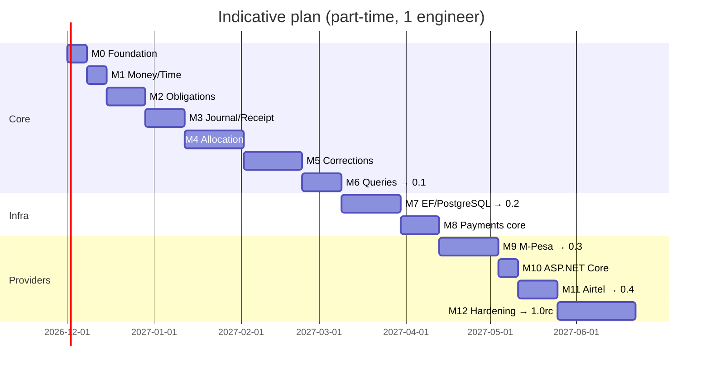

# Document 6 — Implementation Roadmap

Principles:
- Build a working, provably correct financial core **first**, in memory.
- Add persistence second and providers third.
- Every milestone is shippable and leaves `main` green.

Size estimates assume one senior engineer working part-time. **S** ≈ 1 week, **M** ≈ 2 weeks, **L** ≈ 3–4 weeks.

**Global definition of done (applies to every milestone):**
- CI is green on net10.0 and net11.0 (Linux and Windows).
- Warnings are treated as errors.
- Public API files are updated.
- XML docs cover all public types.
- An ADR is written for any new decision.
- The changelog entry is written.
- Coverage of domain code is at least 90% lines. Mutation score (Stryker.NET) on Money and Allocation is at least 80% from M4.
- Docs pages are updated.
- No new third-party dependency in core.

---

### M0 — Foundation (S) — ✅ done 2026-11-18

> **Delivered:**
> - solution (`InstalmentFlow.slnx`) and the 7 package projects (`net10.0`);
> - central package management with pinned versions;
> - analyzers with warnings treated as errors;
> - public API tracking;
> - `src/BannedSymbols.txt` (`DateTime`, system clock, implicit decimal rounding), plus a source-scan test for `double`/`float`, because the banned-API analyzer misses keywords in declarations;
> - `tests/InstalmentFlow.ArchitectureTests` (26 tests), each verified to fail on an injected violation;
> - CI (Ubuntu and Windows × .NET 10 and 11 runtimes), CodeQL, Dependabot;
> - Apache-2.0 licence, NOTICE, README, CONTRIBUTING (DCO), CODE_OF_CONDUCT, SECURITY, GOVERNANCE, CHANGELOG, issue and PR templates;
> - MinVer versioning.
>
> **Deviation:** Microsoft Testing Platform replaces VSTest (xunit.v3 4.x requires it on the .NET 10 SDK).
>
> **Published:** `github.com/TrudeauOkech/instalment-flow`, with CODEOWNERS and the code-of-conduct contact set.
- **Objectives:** a repository that enforces quality from day one.
- **Features:**
  - solution and the 7 package projects (empty);
  - `Directory.Build.props` (nullable, analyzers, deterministic builds, SourceLink);
  - central package management;
  - `global.json`;
  - `.editorconfig`;
  - `BannedSymbols.txt` (`System.Double` in `InstalmentFlow.Money*`, `DateTime.Now`, `DateTime.UtcNow`);
  - GitHub Actions (build, test, pack, API diff);
  - Apache-2.0 LICENSE, CONTRIBUTING, SECURITY, CODE_OF_CONDUCT;
  - ADR-001…010 from the overview decisions.
- **Files:** root config, `.github/`, `docs/decisions/`.
- **Dependencies:** none.
- **Acceptance:** `dotnet build` and `dotnet test` pass. An architecture test fails if core references a forbidden assembly.
- **Tests:** architecture tests (NetArchTest or reflection-based).

### M1 — Money, Currency, Time (S) — ✅ done 2026-11-18

> **Delivered:**
> - `Money` is a sealed, immutable class rather than a struct, so `default(Money)` can never be an amount with no currency.
> - `Currency` has a curated ISO 4217 registry.
> - `TenantClock`:
>   - in a daylight-saving gap, it moves to the first valid local time;
>   - an ambiguous time resolves to the earlier instant;
>   - `ToInstant` is the sanctioned conversion for provider local timestamps such as Daraja `TransTime`.
> - `ExternalReference` and `IdempotencyKey`.
> - `InstalmentFlowException` with stable error codes.
>
> **Tests:** 62 (including 5 CsCheck properties). Allocation tests were mutation-checked: inverting the remainder order, or the tie-break, is caught by a dedicated largest-remainder property.
- **Features:**
  - the `Money` and `Currency` value objects (ISO 4217 table with minor units);
  - arithmetic;
  - comparison;
  - `Allocate(ratios)` using the largest-remainder method;
  - `Split(n)`;
  - `TenantClock` (`TimeProvider` plus IANA zone, converting instants ↔ `BusinessDate`);
  - `ExternalReference`;
  - `IdempotencyKey`.
- **Files:** `src/InstalmentFlow/Money/*`, `Time/*`.
- **Acceptance:**
  - mixing currencies throws;
  - scale overflow throws;
  - `Allocate` always sums to the input;
  - an `Africa/Nairobi` midnight boundary maps correctly.
- **Tests:**
  - properties: `Σ Allocate(m, r) == m`, `|share − ideal| < 1 minor unit`, determinism;
  - unit tests for every operator;
  - time-zone boundary cases (23:59:59 EAT = 20:59:59 UTC).

### M2 — Tenants, obligations and schedules (M) — ✅ done 2026-11-19

> **Delivered:**
> - **Tenancy:** `TenantId`; versioned `TenantPolicy` (default grace period, `ReferenceFormat` with normalisation and a regex match timeout); `ITenantAdmin`; `InstalmentFlowFactory.CreateInMemory(...)`; the tenant-scoped `IInstalmentFlow` with Accounts, Obligations, Plans and Queries.
> - **Obligations:** principal, interest, fee and penalty components, with charge codes for fees and penalties.
> - **Plans:** the `Equal` generator (with deposit; remainder on the last instalment), `Custom`, and `Using(IScheduleGenerator)`; `IBusinessCalendar`. Every schedule is validated against I-13. `Plans.SupersedeAsync` is allowed only without financial history (`IF4001`).
> - **Status:** derived as payment state × timing, with days past due counted from the due date, arrears, and paid-through date.
> - **Store:** an immutable in-memory store with an account version check and atomic per-tenant uniqueness for external IDs and payment references.
>
> **Decisions:**
> - Domain types and storage ports are `internal`. The ports become public in M7.
> - `IInstalmentFlowFactory.For` was renamed `ForTenant`, because analyzer CA1716 flags `For` as a VB keyword.
> - `GracePeriod.OfDays(n)` replaces `GracePeriod.Days(n)` from the doc 04 sketch.
> - `Deposit` carries its own due date.
>
> **Deferred to M3:** idempotent replay of a request with the same key. Until then, duplicate external IDs are rejected (`IF1007`).
>
> **Tests:** 133 in total (107 in `InstalmentFlow.Tests`). Mutation checks covered the grace boundary, removing I-13, gaps in the paid-through date, and the store's reference uniqueness.
- **Features:**
  - `TenantId`, `TenantPolicy` (versioned), `IInstalmentFlowFactory.For(tenant)`, and the tenant-scoped facade skeleton (ADR-007);
  - `CustomerAccount` and `Obligation` entities with component balances (principal, interest, fee, penalty), external ID, and a payment reference validated against the tenant format;
  - `RepaymentPlan` (versioned) and schedule generators (`Equal`, `DepositPlusEqual`, `Custom`) for daily, weekly, monthly and every-N-days frequencies;
  - month-end rules (Jan 31 → Feb 28 or 29);
  - grace periods;
  - derived instalment status;
  - `PaidThroughDate`;
  - `IBusinessCalendar` (default: no shifting);
  - plan lifecycle: create, and `Plans.SupersedeAsync` only without financial history (ADR-011).
- **Files:** `Tenancy/*`, `Domain/Accounts`, `Domain/Obligations`, `Domain/Plans`.
- **Dependencies:** M1.
- **Acceptance:** the schedule total equals the obligation total (I-13); remainder rounding goes to the last instalment; statuses are correct across grace boundaries; a leap-year schedule is correct; an obligation cannot be created in, or read from, another tenant; a duplicate payment reference within a tenant is rejected, but the same reference in two tenants is allowed.
- **Tests:**
  - generator properties (sum, count, monotonic dates);
  - status as a function over generated `(date, payments)` inputs;
  - snapshot tests of generated schedules (Verify).

### M3 — Journal, payment recording, identification and exceptions (L) — ✅ done 2026-11-19

> **Delivered:**
> - **Journal:** a double-entry journal, built with a balance check (I-1), and the chart of accounts (clearing, unidentified, unapplied, receivable, origination). Opening an obligation now posts its receivables.
> - **Recording:** `Payments.RecordAsync` always records (ADR-002): a payment fact, one funds lot, and a journal transaction. Funds go to the customer's unapplied funds or to the tenant's unidentified funds, with one aggregate per source.
> - **Identification:** a pure `PaymentIdentifier` covering ADR-009 cases 1–7, plus `NoPayableObligation`. `PaymentTarget.ForReference/ForObligation/ForCustomer/Unknown`; `IPaymentReferenceResolver`, which cannot bypass ambiguity. A directed obligation is recorded on the lot for M4 to allocate.
> - **Exception queue:** `ListOpenAsync`, `GetAsync`, `AssignToCustomerAsync` (journal-backed, with an optional obligation directive) and `DismissAsync`, which is blocked while funds are unidentified (I-22). `AllocateToObligationAsync` comes in M4 and `MarkForRefundAsync` in M5.
> - **Commands:** an atomic `Commit` (aggregates with expected versions, journal, facts, exceptions, idempotency, events) and a `CommandRunner`. The runner replays on the same key and payload, rejects the same key with a different payload (`IF1002`), reports the same provider reference as `Duplicate` (or `IF1011` if the amount differs), and retries conflicts with jittered backoff (default 10 attempts, configurable with `UseConcurrencyRetries`).
> - **Events:** domain events are collected per commit. They stay internal until the outbox arrives in M7.
> - **Verification:** an internal `LedgerVerifier` checks I-1, I-3, I-5, I-10 (funds, receivables, clearing), I-11, I-18, I-19 and I-22 by folding the journal. Tests assert it after scenarios; it becomes public in M6.
>
> **Tests:** 164 in total (138 core), stable over 10 repeated runs and on .NET 11. Mutation checks: the store duplicate check (which needed a new cross-aggregate test to catch), the idempotency hash, the ambiguity rule, the ledger account choice, and the I-22 dismissal guard.
- **Features:**
  - journal builder with the balance check;
  - chart-of-accounts conventions;
  - `Payments.RecordAsync`, which **always records** (ADR-002);
  - funds lots;
  - the identification pipeline with all seven ADR-009 outcomes, `PaymentTarget`, reference normalisation and `IPaymentReferenceResolver`;
  - customer unapplied funds and tenant unidentified funds;
  - the payment exception queue (`Exceptions.ListOpenAsync`, `AssignToCustomerAsync`, `DismissAsync`; `AllocateToObligationAsync` lands in M4);
  - idempotency (key plus payload hash);
  - `IAccountStore`, `IIdempotencyStore` and the in-memory store with versioned optimistic concurrency;
  - engine retry loop;
  - domain events collected per command.
- **Dependencies:** M2.
- **Acceptance:**
  - I-1, I-3, I-4, I-5, I-11, I-19, I-20 and I-22 hold;
  - every row of the ADR-009 decision table has a passing executable spec;
  - **Scenario 1** (five identical callbacks → one payment) passes;
  - the same key with a different amount raises `IF1002`, and the same provider reference with a different amount raises `IF1011`.
- **Tests:**
  - unit;
  - a CsCheck model-based test of the command sequence against a simple reference model;
  - CsCheck `SampleParallel` duplicate receipts on the in-memory store;
  - a property test that a generated payment with any identification outcome is recorded exactly once and never allocated when ambiguous.

### M4 — Allocation engine (L) — ✅ done 2026-11-21

> **Delivered:**
> - **Strategies:** `IAllocationStrategy`, `AllocationContext` and `AllocationPlan` with `FillInOrder`. Built-ins `oldest-due-first@1` (default), `current-due-first@1`, `principal-first@1`, `charges-first@1`, `proportional@1` (largest remainder across obligations) and directed allocation, all sharing one tie-break order (due date, opened, obligation ID, instalment, component rank).
> - **Validation:** the engine validates every plan. It rejects over-settlement, overspending, non-eligible or repeated targets, a foreign currency and non-positive lines (`IF2002`). A faulty or throwing strategy leaves the payment recorded and held with `AllocationFailed`.
> - **Policy:** pinned strategy version, component order (charges never first by default, R-F11) and the future-instalment policy (`HoldAsCredit`, `ApplyToNextInstalments`, `PrepayPrincipal`). Allocations record the strategy and the policy version.
> - **Commands:** recording allocates identified funds in the same command, with no spill-over (I-21) and holding without an instruction (I-20). `Allocations.AllocateAsync`, `Exceptions.AllocateToObligationAsync`, and `AssignToCustomerAsync` with an obligation. Custom strategies are registered with `AddAllocationStrategy`; an unknown one is `IF2003`.
> - **Verification:** the ledger verifier also checks I-6, I-12 and I-23.
>
> **Tests:** 199 in total (173 core). The golden tables in `docs/allocation-strategies/*.md` run as specs; there are CsCheck properties for conservation, no over-settlement, eligibility, determinism (I-14) and `Proportional` remainder bounds. Manual mutation checks: 17 mutants on strategies, validator, due boundary and future-instalment policies. Two survived (instalment-sequence tie-break and in-instalment component order) and were killed by two new spec examples. One is equivalent: the `Proportional` funds cap, because when funds cover everything each share already reaches its due amount. Stryker.NET is not wired in yet.
- **Features:**
  - `IAllocationStrategy`, `AllocationContext`, `AllocationPlan` builder and plan validator;
  - built-ins: `OldestDueFirst`, `CurrentDueFirst`, `PrincipalFirst`, `ChargesFirst`, `Proportional`, `Directed`;
  - future-instalment policies;
  - directed allocation for identified payments, with **no spill-over onto other loans** (I-21);
  - `Allocations.AllocateAsync` and `Exceptions.AllocateToObligationAsync` for manual or customer-directed allocation of unapplied funds;
  - `SoleObligation` and `MultipleObligations` tenant policies (default: hold);
  - strategy registry with versions; allocations record the strategy and policy version;
  - cross-obligation strategies, used only when opted in or explicitly requested.
- **Dependencies:** M3.
- **Acceptance:**
  - **Scenario 2** (2×400 against 500 gives 300 credit) and **Scenario 4** (100+150+50+200 settles 500, with four traceable allocations) pass;
  - a malicious strategy that over-allocates, or targets a non-eligible obligation, is rejected by the validator;
  - a customer with two loans paying with no reference has the funds held and an `AllocationInstructionRequired` exception raised;
  - determinism holds (I-14).
- **Tests:**
  - per-strategy golden tables in `docs/allocation-strategies/*.md`, which double as executable specs;
  - properties: no over-settlement, conservation, determinism, `Proportional` remainder bounds;
  - mutation testing on strategies.

### M5 — Corrections: reversal, refund, charges, waivers (L) — ✅ done 2026-11-21

> **Delivered:**
> - **Reversals:** `Payments.ReverseAsync` takes the amount from the lot's remaining funds first, then unwinds the payment's allocations most recent first (allocation-reversal facts; the originals are never edited), and records anything already refunded as a deficit on `acct:{id}:reversal-receivable:{ccy}`. Re-opened instalments are re-allocated from other unapplied funds under `ReallocateAfterReversal` (default on; directed funds still never move to another loan). Unidentified funds can be reversed too. I-8 is enforced with `IF2001`.
> - **Duplicates and parking:** a reversal reference is unique per tenant (a repeat is `Duplicate`; different details are `IF2004`). A reversal for a payment not yet recorded is parked and applied when the payment arrives, in the same command; the store refuses a commit in which parking and recording would miss each other. A parked reversal in another currency, or larger than the payment, is applied as far as it can be and raises `ParkedReversalNotApplied` (recording never fails, ADR-002).
> - **Charges and waivers:** `Charges.PostAsync` adds host-calculated amounts to one instalment (`NextUnpaidInstalment`: the first unpaid instalment not yet past due, else the last unpaid one; `Immediately`: the latest instalment already due, else the first; `OnInstalment(n)`; tenant default `NextUnpaidInstalment`). A charge on a settled obligation re-opens it. `Charges.ReverseAsync` unwinds only the shortfall the instalment's outstanding cannot absorb; the freed funds stay unapplied. `Charges.WaiveAsync` clears the oldest outstanding amounts of one component. Charges count as financial history, so a charged plan cannot be superseded.
> - **Refunds:** `Refunds.RequestAsync` takes the oldest eligible funds first and skips funds with an open exception (`Exceptions.MarkForRefundAsync` handles those, including unidentified funds). `CompleteAsync` confirms (out of clearing) or fails. A failed refund returns the credit; if the payment was reversed while the refund was pending, it settles that deficit instead. A failed refund from the exception queue raises a new `RefundFailed` exception.
> - **Cancellation and settlement:** `Obligations.CancelAsync` requires one write-off line per outstanding component, equal to it (`IF4002`); it writes off, cancels the plan and the obligation, and keeps allocations and unapplied funds. A later reversal shows the amount owed again on the cancelled obligation. `QuoteEarlySettlementAsync` splits what is outstanding into due and not yet due and nets off unapplied funds; settlement then goes through waivers plus `AllocateFundsRequest.FutureInstalments` (`PrepayPrincipal` or `ApplyToNextInstalments`).
> - **Verification:** the verifier folds the new facts: I-5 with reversed and refunded parts, I-6 against allocations net of unwinds, waivers and charges, I-8, I-11 (deficits only in the reversal receivable), I-13 with charges, I-17 conservation per currency, refund payable and clearing net of reversals and confirmed refunds.
>
> **Tests:** 250 in total (224 core), stable over 5 repeated Release runs. They cover Scenario 3, the partial-reversal tables, reversal-after-refund deficits, interleavings of reversals with payments and allocations, and the I-9 property (receiving then reversing a payment leaves the instalments and credit as they were; with later payments, the net position is unchanged). Manual mutation checks: 21 mutants on the I-8 guard, LIFO order, deficits, re-allocation, the store guards, the refund state machine, write-off matching, the charge due rules and re-opening. 12 were killed at once, and two more once rewritten to compile. Seven survived the first pass. Five were store guards that only matter under concurrency, and one was the charge-reversal shortfall; new store-level and concurrency tests (parking and refund completion touch no aggregate version) and a two-charge reversal test killed all six. The seventh is equivalent: skipping allocation when a parked reversal empties the lot, because an empty lot allocates nothing.
- **Features:**
  - `ReversePayment` (full and partial, unwinding allocations LIFO per lot, then optional re-allocation);
  - reversal deficit;
  - duplicate reversal detection by provider reference;
  - "reversal before payment" parking (pending reversals keyed by external reference, applied on arrival);
  - `Charges.PostAsync` for host-calculated interest, fees and penalties, with a due policy and charge code (ADR-008); `Charges.ReverseAsync`;
  - `Charges.WaiveAsync`;
  - `Refunds.RequestAsync` and `CompleteAsync`, recorded only (ADR-010), and `Exceptions.MarkForRefundAsync`;
  - `Obligations.CancelAsync`: voids unpaid instalments, sets the plan to Cancelled, and requires explicit write-off lines with a reason (ADR-011);
  - `QuoteEarlySettlement` and early settlement through `PrepayPrincipal`.
- **Dependencies:** M4.
- **Acceptance:**
  - **Scenario 3** (reverse 500 after settlement restores 500 outstanding, with history intact) passes;
  - I-8 and I-9 hold;
  - a refund failure returns the credit.
- **Tests:**
  - property I-9 (receive P, then reverse P, is equivalent to never receiving P, modulo re-allocation);
  - partial-reversal tables;
  - reversal-after-refund deficit;
  - interleavings of reversals with allocations (in-memory parallel).

### M6 — Queries, history and Verify → **release 0.1.0-preview** (M) — ✅ done 2026-11-21 — published as 0.1.0-preview.1

> **Delivered:**
> - **As-of:** `AsOf.Date(day)` (end of a business date) or `AsOf.At(instant)` on the account, obligation and schedule queries. Every money fact references its journal transaction, so a past state is the fold of the facts of the transactions recorded up to the cut-off, replayed in journal order (funds lots, including reversal deficits and failed refunds settling them; instalment components). Plan versions, which carry no money, are selected by their own timestamps. A cut-off at or after now returns the current state.
> - **Queries:** `TracePaymentAsync` (every step of one payment; its parts reconcile to the amount), `GetStatementAsync` (one line per journal transaction, with the change and running balance of the customer's net position), `ReadJournalAsync` (cursor-based export in pages, with stable kind and source-type names) and `VerifyAsync` (the verifier's violations by invariant).
> - **Testing package:** the scenario DSL from doc 04 §6 (customers, loans, reference resolver, payments, duplicate deliveries, reversals, charges, waivers, refunds, days passing), with assertions that need no test framework. The simulator steps come with the payments package (M8), so `InstalmentFlow.Testing` references only the core for now.
> - **Samples and docs:** samples 01–03 check their own results and end with `VerifyAsync`; CI runs them on every leg. New docs: concepts and financial invariants (enforcement and verification per invariant). The README has a quickstart.
> - **Release:** the five packages still without content are marked non-packable, so 0.1 ships `InstalmentFlow` and `InstalmentFlow.Testing`. CI has a `publish` job that pushes packages for `v*` tags through the `nuget` environment. Publishing uses nuget.org Trusted Publishing (no stored API key); 0.1.0-preview.1 was published from the `release/0.1` branch (M6 plus the Trusted Publishing workflow).
>
> **Tests:** 266 in total (240 core). The random-history property runs commands (payments, customer payments, reversals, charges and their reversals, waivers, refunds and their completion, sweeps, days passing). After every step it checks `Verify` and that the history fold reproduces the live projections; at the end it checks that every earlier state is reproduced as of its time. 10⁵ histories pass locally (about 90 seconds), and CI runs 10⁵ on one leg. It found one real difference while being written: an emptied charge component kept by the projection but dropped by the fold. Manual mutation checks: 9 mutants on the fold, statement and as-of routing. Six were killed at once; the other three (a failed refund settling a deficit, obligations opened after the cut-off, assigned unidentified funds) were killed by targeted tests.
- **Features:**
  - `IInstalmentQueries` (account, obligation, schedule, statement, `TracePayment`);
  - `AsOf` reconstruction by journal fold;
  - `VerifyAsync` (all of the "V" invariants in doc 02);
  - journal export cursor;
  - `InstalmentFlow.Testing` scenario DSL;
  - samples 01–03;
  - docs (concepts, strategies, invariants).
- **Acceptance:** a projection equals the journal fold for 10⁵ random histories (I-10). Samples run in CI. NuGet preview is published.
- **Tests:** property-based random histories with `Verify` after every step, and an as-of check that a past query is unaffected by later commands.

### M7 — EF Core / PostgreSQL store → **0.2.0** (L) — ✅ done 2026-11-21 — published as 0.2.0-preview.1

> **Delivered:**
> - **Schema:** EF Core mappings and one initial migration for the doc 05 schema, with the differences listed in doc 05 §8. It has tenant-first composite keys and foreign keys and `numeric(19,4)` money, and named constraints so refusals map back to engine errors. SQL in the migration adds append-only and no-truncate triggers on facts, the deferred balance check (I-1), and forced row-level security on every table using `set_config('instalment_flow.tenant_id', …, true)`. `MigrateAsync` applies migrations and grants the application and dispatcher roles. `GenerateMigrationScript` produces idempotent SQL. The factory refuses a missing or newer schema.
> - **Store:** the same internal ports as the in-memory store (ADR-017; the store and core must be the same version). Each command attempt runs in one transaction (command scopes). Version checks are atomic `UPDATE … WHERE version = v`, and only changed projection rows are written. Facts are appended, and recording order is the journal sequence plus the position in the commit. An advisory lock per provider reference stops a parked reversal and its payment from missing each other. Unique, foreign-key and RLS violations map to `Duplicate`, `IF1002`, `IF1006`, `IF1007`, `IF1012`, `IF2004`, `IF2006` and `IF5001`. Pessimistic mode locks the account row. `Enlist` joins a host transaction with a savepoint per attempt. Instants are stored in UTC.
> - **Outbox:** events are written in the command's transaction. `OutboxDispatcher` claims with `FOR UPDATE SKIP LOCKED` and a lease, publishes outside the claim, and marks afterwards (at least once, with backoff). An event waits while an earlier event of its account is pending (per-account order).
> - **Verify:** the PostgreSQL store's `VerifyAsync` runs the invariant checks as SQL aggregates. On PostgreSQL the test helper runs both verifiers, snapshot and SQL, after every scenario.
>
> **Acceptance:** the whole core suite (240 tests) runs against PostgreSQL with `IF_STORE=postgres`, one fresh database per engine, as the application role under RLS, and passes; CI runs it. A direct `UPDATE ledger_entries` fails, for the app role (no grant) and the owner (trigger). An unbalanced insert fails at commit. Without the tenant setting every table reads as empty. A cross-tenant foreign key fails.
>
> **Tests:** 283 in total (240 core, 26 architecture, 17 PostgreSQL store), all passing in memory and on PostgreSQL (17.12 in Testcontainers). The store tests cover: cross-tenant IDs and raw SQL, 50 parallel tasks of receipts and reversals on 5 accounts (0 violations), a connection terminated before commit then retried (exactly one payment), a crash after publish (redelivered), per-account outbox order under failures and three competing dispatchers, migrations up, down and up on an empty database, host transactions (rollback undoes, commit keeps), pessimistic mode, restart replay, and schema checks. The first full PostgreSQL run found that EF Core reorders the inserts of one `SaveChanges`, which broke LIFO order; recording order now comes from the journal sequence and position. Manual mutation checks: 5 mutants on the commit path (version check, reversal-race guard, lot writes, refund state, duplicate mapping), all killed.
> **Not yet:** partitioning of `ledger_entries`, a configurable schema name, a DI `MigrateInstalmentFlowAsync` extension (M10), and the payments-package tables (M8).
- **Features:**
  - EF mappings matching doc 05;
  - migrations;
  - append-only and balance triggers;
  - **row-level security policies on every tenant table, composite tenant foreign keys, and `SET LOCAL` tenant per transaction**; tenant policy, provider-account routing and exception tables;
  - optimistic save with a version check;
  - unique-violation → `Duplicate` mapping;
  - optional pessimistic mode;
  - outbox table and `OutboxDispatcher`;
  - `IIntegrationEventPublisher`;
  - host-owned transaction support;
  - `MigrateInstalmentFlowAsync`;
  - SQL-based `Verify`.
- **Dependencies:** M6.
- **Acceptance:**
  - the full core test suite runs against PostgreSQL (shared behavioural tests parameterised by store);
  - a direct `UPDATE ledger_entries` fails;
  - an unbalanced insert fails at commit;
  - with the tenant setting missing, every query returns zero rows (fails closed);
  - a cross-tenant foreign key insert fails.
- **Tests (Testcontainers):**
  - the cross-tenant suite: every command and query with another tenant's IDs gives `IF5001` or not-found, and raw SQL under the app role cannot see other tenants;
  - 50 parallel tasks × random receipts and reversals on 5 accounts, then `Verify` reports 0 violations;
  - failure injection: kill the connection after `INSERT payment` but before commit, then retry, giving exactly one payment;
  - a crash between commit and outbox dispatch still delivers the event (at-least-once);
  - outbox per-account ordering;
  - migration up-and-down smoke test on an empty database.

### M8 — Payments core: inbox, intents, tenant routing, simulator, reconciliation (M) — ✅ done 2026-11-21

> **Delivered:** `InstalmentFlow.Payments`, in memory and on PostgreSQL (ADR-018, doc 05 §8):
> - **Adapters and events:** the adapter interfaces with capability flags, checked at start-up, and `NormalisedPaymentEvent` with deduplication keys derived from the event.
> - **Inbox:** stores each event before processing, once per key. The processor has leases, back-off, a failed state and requeue.
> - **Routing:** provider-account routing, plus `ITenantRouter` for shared accounts.
> - **Intents:** stored before the provider is called; a timeout is ambiguous, never failed. The resolver queries status by correlation ID or merchant reference, and intents expire after a time to live.
> - **Reconciliation:** runs with a cursor, discrepancies raised once, a per-tenant `ReversedAtProvider` policy and a CSV statement importer.
> - **Simulator:** `SimulatedProvider` with every fault ADR-016 lists.
> - **Core:** one addition, `ListPaymentsAsync`.
>
> **Acceptance:**
> - A dropped callback plus a statement line ingests the payment once; a late callback after that is a duplicate.
> - An ambiguous intent never initiates twice, even with ten concurrent requests on one key.
> - A `MissingAtProvider` line raises one discrepancy and changes nothing.
>
> **Tests:** 70 payments tests, all passing in memory. 48 of them run on PostgreSQL, where the randomised test runs 3 seeds instead of 25. They cover:
> - duplicate, delayed (5 h), dropped, reordered (reversal before payment) and forged callbacks;
> - timeout-then-success, with and without the callback;
> - declined, refused, unanswered (back-off, then expiry) and late-confirmed intents;
> - routing and setup;
> - the CSV importer;
> - parallel processors.
>
> A randomised test mixes faults on 5 to 20 payments per seed: every payment ends up recorded exactly once, and the ledger verifies. 7 manual mutation checks: 6 killed, and 1 survivor that turned out to be equivalent to the original code. The suite is 354 tests in memory, and the core suite (240) still passes on PostgreSQL.
>
> **Not yet:** metrics and tracing (doc 03 §8); hosted workers and the callback endpoints, which come with `InstalmentFlow.AspNetCore` (M10); and inbox payload retention.

- **Features:**
  - `InstalmentFlow.Payments`:
    - adapter SPI and capability flags;
    - `NormalisedPaymentEvent`;
    - provider inbox with processor worker;
    - tenant routing (`tenant_provider_accounts`, `ITenantRouter`) and hand-off to core identification;
    - `PaymentIntent` state machine with `IntentResolver` worker (status polling with back-off and a TTL);
    - reconciliation engine and CSV statement importer;
    - discrepancy model.
  - **The simulated provider** (ADR-016), with paybill and push flows and fault injection: duplicate, delay, drop, reorder, timeout-then-success, amount mismatch, statement-only reversal. It is the first provider adapter and the basis for every M8 test.
- **Dependencies:** M7 (EF tables for inbox and intents) or the in-memory store.
- **Acceptance:**
  - missing callback plus a statement line ingests the payment once;
  - an ambiguous intent never double-initiates;
  - a `MissingAtProvider` line raises a discrepancy and makes no automatic change.
- **Tests:**
  - simulator-driven: duplicate, delayed (hours), missing, out-of-order callbacks (reversal before payment);
  - timeout-then-success.

### M9 — M-Pesa adapter → **0.3.0** (L) — ✅ built 2026-11-21; sandbox verification pending before release

> **Spike:** the official Daraja portal could not be read (it renders in the browser and needs an account). So the
> adapter follows what independent sources agree on, and accepts each variant they disagree on. Each item's confidence
> is recorded in [docs/integrations/mpesa.md](../integrations/mpesa.md). Findings that changed the design:
> - STK results carry no shortcode, so the endpoint passes it;
> - STK has no merchant reference, so a push whose reply was lost cannot be matched to its intent (the payment is still recorded, as unidentified);
> - the STK query returns no receipt;
> - C2B v2 payer numbers may be hashed rather than masked.
>
> **Delivered** (`InstalmentFlow.Payments.Mpesa`):
> - **Tokens:** an OAuth token cache per consumer key, refreshed early, with a single retry on an expired token.
> - **STK:** push requests, refused before sending if they are not whole shillings, have a reference over 12 characters, or the phone number is invalid. Daraja client errors count as refused, and server errors or timeouts as ambiguous. The STK query reads payment as pending until a receipt arrives.
> - **C2B:** URL registration; confirmation parsing, which reads strings or numbers, converts Nairobi time and drops payer names; validation parsing and replies (`C2B00011`–`13`).
> - **Transaction Status:** requests with an RSA security credential, and result parsing for a single parameter or an array.
> - **Pull Transactions:** registration, and paged reading as an `IStatementSource`, handling the sandbox's spaced keys, `1001` sent with HTTP 500, and dates with or without an offset. Only reversals that name their payment are used.
> - **Org-portal statements:** a preset for the generic CSV importer. It finds the header row and keeps only completed rows.
> - **Payments package:** per-shortcode credentials (`IProviderCredentialSource`); `ProviderCallback.ProviderAccount`; `CallbackParseResult.Hold`, so a fractional amount waits in the inbox for a person and is never rounded.
> - **Sample 04:** sandbox runs, recording Daraja's responses as fixtures.
>
> **Tests:** 49 tests on an in-process fake Daraja, using 19 fixtures whose provenance is listed in their README. An in-process HTTP handler replaces WireMock.Net, because these tests only need to check requests and responses. They cover:
> - every documented payload variant;
> - fuzzing: missing fields, wrong types, a 70 KB body, deep nesting and 2,000 random or mutated payloads, none of which throw;
> - a token expiring mid-flight;
> - end-to-end flows through the inbox, intents and reconciliation (Pull Transactions and the org-portal CSV).
>
> 4 manual mutation checks, all killed.
>
> **Before release (acceptance):** run sample 04 against a sandbox app, replace the `documented` fixtures with recorded ones, and update mpesa.md and doc 03 §7.2. Callbacks need the M10 endpoints, or any public listener.

- **Pre-work (spike, S):**
  - verify against the official Daraja portal: current API versions (STK, C2B v2, Transaction Status, Pull), callback IP ranges, retry behaviour, statement export formats, and sandbox limits;
  - record real sandbox payloads as contract fixtures.
- **Features:**
  - OAuth token cache;
  - STK push and query;
  - C2B URL registration helper;
  - validation and confirmation parsing (masked MSISDN, `TransTime` EAT parsing, whole-shilling check);
  - Transaction Status (async with ResultURL);
  - Pull Transactions `IStatementSource`;
  - parsing of reversal lines in Pull and statement data, which feeds `Payments.ReverseAsync` through reconciliation. **The adapter never initiates reversals or B2C** (ADR-010);
  - SecurityCredential RSA encryption (needed for Transaction Status);
  - per-tenant credentials through `IProviderCredentialSource`;
  - org-portal CSV statement parser.
- **Files:** `src/InstalmentFlow.Payments.Mpesa/*`, `docs/integrations/mpesa.md`.
- **Acceptance:** sandbox end-to-end through sample 04 (STK and C2B simulate); contract tests pass on recorded payloads.
- **Tests:** WireMock.Net contract tests; payload fuzzing (missing fields, wrong types, huge bodies); a token-expiry mid-flight test.

### M10 — ASP.NET Core integration (S) — ✅ done 2026-11-21

> **Delivered:** `InstalmentFlow.AspNetCore`. It references only the core and payments packages (ADR-013), so PostgreSQL, M-Pesa and the outbox dispatcher come in through delegates and payments-package interfaces:
> - **Set-up:** `AddInstalmentFlow` creates the engine and payments at start-up. `IInstalmentFlow` is scoped to the request's tenant through `ITenantContext` (claims or route).
> - **Callbacks:** `MapInstalmentFlowCallbacks` checks a constant-time path secret, then the IP allowlist, then a body limit, and acknowledges each callback once stored, in the provider's own format.
> - **Validation:** answered within a 5 s budget, accepting by default; tenants can opt in to refusing unknown references.
> - **Simulator endpoints:** refused outside Development unless the host overrides it; M12's security review tightened this from Production only.
> - **Errors and health:** `ProblemDetails` with `errorCode`. Health checks cover inbox backlog and failures, ambiguous intents, reconciliation age and outbox lag; `PaymentsHealth` comes from the store's cross-tenant counts.
> - **Workers:** background workers, including host-supplied work.
> - **Sample 05:** a web host that runs against itself.
>
> **Acceptance:** 20 tests on a real ASP.NET Core test server (`TestServer`, the engine behind `WebApplicationFactory`) cover each endpoint. They include 25 concurrent duplicate posts, which are all acknowledged and stored once. They also cover: a wrong secret, a forged signature, oversized bodies with and without `Content-Length`, allowed and refused networks (including IPv4-mapped IPv6), M-Pesa acknowledgements, validation defaults, opt-in and the time budget, tenant contexts, `ProblemDetails`, health states, the simulator's Production guard, and workers. Stable over repeated runs.
>
> **Not yet:** a DI `MigrateInstalmentFlowAsync` helper. Migrations stay an explicit `InstalmentFlowPostgres.MigrateAsync` call, because the ASP.NET Core package cannot reference the EF package. A sample inside an existing loan system's `DbContext` (with `Enlist`) moves to the documentation milestone.

- **Features:**
  - `MapInstalmentFlowCallbacks`, with tenant resolution from the provider account;
  - `ITenantContext` implementations (claims, route);
  - simulator endpoints, refused in `Production` unless the host overrides this;
  - path-secret and IP-allowlist filters;
  - validation endpoint with a latency budget (it times out internally before 8 s and answers with the configured default);
  - `ProblemDetails` mapping;
  - health checks (outbox lag, inbox backlog, intent ambiguity, last reconciliation);
  - sample 04 and sample 05 (existing LMS).
- **Acceptance:** `WebApplicationFactory` tests cover each endpoint, including concurrent duplicate posts.

### M11 — Airtel Money adapter → **0.4.0** (M) — ✅ built 2026-11-22; UAT verification pending before release

> **Spike:** the developer portal could not be read. The six sources disagree on the collection path (v1 or v2), the token lifetime, the meaning of every `DP` code and callback signing. None documents till notifications or statements. See [docs/integrations/airtel.md](../integrations/airtel.md).
>
> **Delivered** (`InstalmentFlow.Payments.AirtelMoney`):
> - **Tokens:** OAuth, refreshed at 80% of the stated lifetime, plus a single retry after a 401.
> - **USSD push:** the disputed choices are options (path, number format, host). Only an explicit success is "accepted"; refusal codes are ambiguous, never failed.
> - **Enquiry:** `TS` succeeded, `TF`/`TE` failed, `TA` ambiguous, `TIP` in progress. It reads both response shapes.
> - **Callbacks:** treated as prompts.
>
> **Payments package:**
> - `NormalisedPaymentEvent.RequiresVerification`: the inbox confirms untrusted collection successes and failures with the status query, so forged ones record or fail nothing.
> - A collection amount may be omitted (the intent's is used).
> - `ProviderTransactionRef.RequestedAmount`.
> - `ProviderTransactionStatus.Ambiguous`, which moves an intent to ambiguous.
> - Error code `IF6007`.
>
> **Sample 06:** UAT runs, recording responses.
>
> **Tests:** 33, using 11 documented fixtures on an in-process fake API. They cover the request shape and options, token refresh, every enquiry status, callback parsing and 2,000 fuzzed payloads. End to end, they cover a confirmed collection, a forged success, a forged failure, in-progress retries, an ambiguous push resolved by enquiry, a lost reply and a duplicate callback. 4 manual mutation checks, all killed.
>
> **Before release (acceptance):** run sample 06 against UAT, settle the disputed rows, and replace the fixtures. Refunds and disbursements are not built (ADR-010).

- **Pre-work spike:** verify:
  - v1 or v2 collection paths;
  - the callback authentication mechanism;
  - whether customer-initiated till payments notify via API in Kenya;
  - statement access.
- **Features:** OAuth; USSD push; callback parsing and verification; enquiry (`TS`, `TF`, `TA`, `TIP` mapping, with `TA` treated as ambiguous). **No refund or disbursement initiation** (ADR-010).
- **Acceptance:** sandbox end-to-end; contract tests.

### M12 — Hardening → **1.0.0-rc** (L) — in progress (pilot pending)

> **Phase 1 (observability and performance), done 2026-11-22:**
> - **Telemetry:** OpenTelemetry conventions are final, with spans and metrics under `InstalmentFlow` across all packages and no personal data in attributes ([docs/observability.md](../observability.md)).
> - **Benchmarks:** a BenchmarkDotNet suite, plus a PostgreSQL harness for NFR-4.
> - **NFR-4 is met:** p95 11–18 ms (target under 25), and 829–912 payments/s (target 500 or more), after an account cache in the PostgreSQL store and change-only projection writes. The first measurement was p95 96.7 ms and 80/s ([docs/performance.md](../performance.md)).
> - **Correctness gap closed:** schedule loads had no `ORDER BY` (from M7); they are ordered by key now.
> - **Partitioning deferred** with data (ADR-019).
>
> **Phase 2 (security review), done 2026-11-23:** threat model with STRIDE and a hardening checklist ([docs/security/threat-model.md](../security/threat-model.md)). Six findings, no high-severity ones open:
> - F1 (unsigned M-Pesa callbacks) fixed: `ConfirmByStatementAbove` holds large callback payments until a statement confirms them, and a warning is logged at start-up for unprotected providers.
> - F2 fixed: simulator endpoints are refused outside Development.
> - The others are accepted or documented.
> - No vulnerable packages; no injectable SQL.
>
> **Phase 3 (documentation), done 2026-11-23:**
> - **Site:** a DocFX site with the guides and the API reference, published to GitHub Pages by `docs.yml`.
> - **Operations:** runbook ([docs/operations.md](../operations.md)).
> - **Failure scenarios:** all 29 of doc 07 §6, each linked to its tests ([docs/failure-scenarios.md](../failure-scenarios.md)). Three new scenario tests: 4, 6 and 21. Two scenarios differ from the design and are documented: 16 (reassignment not built) and 17 (quotes are snapshots).
> - **Integration guides:** existing loan system, custom provider adapter and general-ledger export.
> - **Compliance notes.**
> - **Sample 07:** inside an existing loan system, with `Enlist`; CI runs it on PostgreSQL.
>
> **Phase 4 (API freeze and load test), done 2026-11-23:**
> - **API freeze:** the core, EF, payments, ASP.NET Core and testing packages are frozen in `PublicAPI.Shipped.txt`. The M-Pesa and Airtel Money packages wait for their sandbox runs. The review found no unsealed classes, no settable state outside options, and no unversioned enums; doc 04's sketches that differ from the shipped API are listed in its §7. The compatibility promise is in [docs/versioning.md](../versioning.md).
> - **k6 load test** of the callback path against a reference host: NFR-4 is met end to end, at 500 payments/s with callbacks acknowledged at p95 3.1 ms, and every acknowledged callback recorded exactly once ([docs/performance.md](../performance.md)). It found:
>   - one inbox worker recorded only 186/s, so hosts now run eight (`WorkerOptions.InboxWorkers`);
>   - lost races evicted the winner's cache entry (engine throughput with colliding writers rose from 704 to 979/s once fixed);
>   - a correctness bug: reads inside a rolled-back host transaction could leave uncommitted state in the cache, wrong for another instance's later commit. Fixed, with a test.
>
> **Next:** the external pilot (the host's), then 1.0.0-rc.1.

- **Features:**
  - OpenTelemetry conventions finalised;
  - BenchmarkDotNet suite (allocation on 5×365 instalments, receive path, Verify throughput);
  - k6 load test against the reference host (target from NFR-4);
  - ledger partitioning;
  - security review and threat model;
  - docs site (DocFX or similar);
  - an external pilot integration;
  - API freeze review.
- **Acceptance:**
  - NFR-4 is met or the targets are revised with data;
  - zero high-severity findings;
  - a pilot runs in production (shadow mode) for 30 days with daily `Verify` passing and reconciliation discrepancies explained.

### Post-1.0 candidates
In rough priority order:
1. **Payment distribution** between financier, dealer and insurer (ADR-012). It is confirmed as wanted, and the 1.0 data model is ready for it.
2. Restructure and reschedule (a replacement plan version plus re-allocation, keeping the original; ADR-011).
3. Provider refund and reversal initiation (`IRefundInitiator`, ADR-010).
4. `IChargePolicy` automatic penalties.
5. Pluggable interest calculators (flat, reducing balance), with jurisdiction docs.
6. Back-dated replay (value-date ordering).
7. Stronger tenant isolation options (schema-per-tenant or database-per-tenant).
8. SQL Server store.
9. TigerBeetle journal backend.
10. `InstalmentFlow.Analytics` (behaviour features).
11. More providers (T-Kash, bank virtual accounts, card).
12. A reference back-office UI, including an exception work queue (a separate repository).

