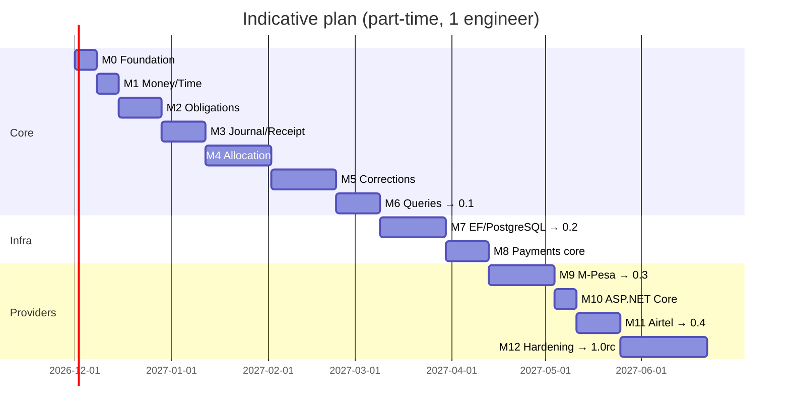

# Document 6 — Implementation Roadmap

Principles:
- Build a working, provably correct financial core **first**, in memory.
- Add persistence second and providers third.
- Every milestone is shippable and leaves `main` green.

Size estimates assume one senior engineer working part-time. **S** ≈ 1 week, **M** ≈ 2 weeks, **L** ≈ 3–4 weeks.

**Global definition of done (applies to every milestone):**
- CI is green on net10.0 and net11.0 (Linux and Windows).
- Warnings are treated as errors.
- Public API files are updated.
- XML docs cover all public types.
- An ADR is written for any new decision.
- The changelog entry is written.
- Coverage of domain code is at least 90% lines. Mutation score (Stryker.NET) on Money and Allocation is at least 80% from M4.
- Docs pages are updated.
- No new third-party dependency in core.

---

### M0 — Foundation (S) — ✅ done 2026-11-18

> **Delivered:**
> - solution (`InstalmentFlow.slnx`) and the 7 package projects (`net10.0`);
> - central package management with pinned versions;
> - analyzers with warnings treated as errors;
> - public API tracking;
> - `src/BannedSymbols.txt` (`DateTime`, system clock, implicit decimal rounding), plus a source-scan test for `double`/`float`, because the banned-API analyzer misses keywords in declarations;
> - `tests/InstalmentFlow.ArchitectureTests` (26 tests), each verified to fail on an injected violation;
> - CI (Ubuntu and Windows × .NET 10 and 11 runtimes), CodeQL, Dependabot;
> - Apache-2.0 licence, NOTICE, README, CONTRIBUTING (DCO), CODE_OF_CONDUCT, SECURITY, GOVERNANCE, CHANGELOG, issue and PR templates;
> - MinVer versioning.
>
> **Deviation:** Microsoft Testing Platform replaces VSTest (xunit.v3 4.x requires it on the .NET 10 SDK).
>
> **Published:** `github.com/TrudeauOkech/instalment-flow`, with CODEOWNERS and the code-of-conduct contact set.
- **Objectives:** a repository that enforces quality from day one.
- **Features:**
  - solution and the 7 package projects (empty);
  - `Directory.Build.props` (nullable, analyzers, deterministic builds, SourceLink);
  - central package management;
  - `global.json`;
  - `.editorconfig`;
  - `BannedSymbols.txt` (`System.Double` in `InstalmentFlow.Money*`, `DateTime.Now`, `DateTime.UtcNow`);
  - GitHub Actions (build, test, pack, API diff);
  - Apache-2.0 LICENSE, CONTRIBUTING, SECURITY, CODE_OF_CONDUCT;
  - ADR-001…010 from the overview decisions.
- **Files:** root config, `.github/`, `docs/decisions/`.
- **Dependencies:** none.
- **Acceptance:** `dotnet build` and `dotnet test` pass. An architecture test fails if core references a forbidden assembly.
- **Tests:** architecture tests (NetArchTest or reflection-based).

### M1 — Money, Currency, Time (S) — ✅ done 2026-11-18

> **Delivered:**
> - `Money` is a sealed, immutable class rather than a struct, so `default(Money)` can never be an amount with no currency.
> - `Currency` has a curated ISO 4217 registry.
> - `TenantClock`:
>   - in a daylight-saving gap, it moves to the first valid local time;
>   - an ambiguous time resolves to the earlier instant;
>   - `ToInstant` is the sanctioned conversion for provider local timestamps such as Daraja `TransTime`.
> - `ExternalReference` and `IdempotencyKey`.
> - `InstalmentFlowException` with stable error codes.
>
> **Tests:** 62 (including 5 CsCheck properties). Allocation tests were mutation-checked: inverting the remainder order, or the tie-break, is caught by a dedicated largest-remainder property.
- **Features:**
  - the `Money` and `Currency` value objects (ISO 4217 table with minor units);
  - arithmetic;
  - comparison;
  - `Allocate(ratios)` using the largest-remainder method;
  - `Split(n)`;
  - `TenantClock` (`TimeProvider` plus IANA zone, converting instants ↔ `BusinessDate`);
  - `ExternalReference`;
  - `IdempotencyKey`.
- **Files:** `src/InstalmentFlow/Money/*`, `Time/*`.
- **Acceptance:**
  - mixing currencies throws;
  - scale overflow throws;
  - `Allocate` always sums to the input;
  - an `Africa/Nairobi` midnight boundary maps correctly.
- **Tests:**
  - properties: `Σ Allocate(m, r) == m`, `|share − ideal| < 1 minor unit`, determinism;
  - unit tests for every operator;
  - time-zone boundary cases (23:59:59 EAT = 20:59:59 UTC).

### M2 — Tenants, obligations and schedules (M)
- **Features:**
  - `TenantId`, `TenantPolicy` (versioned), `IInstalmentFlowFactory.For(tenant)`, and the tenant-scoped facade skeleton (ADR-007);
  - `CustomerAccount` and `Obligation` entities with component balances (principal, interest, fee, penalty), external ID, and a payment reference validated against the tenant format;
  - `RepaymentPlan` (versioned) and schedule generators (`Equal`, `DepositPlusEqual`, `Custom`) for daily, weekly, monthly and every-N-days frequencies;
  - month-end rules (Jan 31 → Feb 28 or 29);
  - grace periods;
  - derived instalment status;
  - `PaidThroughDate`;
  - `IBusinessCalendar` (default: no shifting);
  - plan lifecycle: create, and `Plans.SupersedeAsync` only without financial history (ADR-011).
- **Files:** `Tenancy/*`, `Domain/Accounts`, `Domain/Obligations`, `Domain/Plans`.
- **Dependencies:** M1.
- **Acceptance:** the schedule total equals the obligation total (I-13); remainder rounding goes to the last instalment; statuses are correct across grace boundaries; a leap-year schedule is correct; an obligation cannot be created in, or read from, another tenant; a duplicate payment reference within a tenant is rejected, but the same reference in two tenants is allowed.
- **Tests:**
  - generator properties (sum, count, monotonic dates);
  - status as a function over generated `(date, payments)` inputs;
  - snapshot tests of generated schedules (Verify).

### M3 — Journal, payment recording, identification and exceptions (L)
- **Features:**
  - journal builder with the balance check;
  - chart-of-accounts conventions;
  - `Payments.RecordAsync`, which **always records** (ADR-002);
  - funds lots;
  - the identification pipeline with all seven ADR-009 outcomes, `PaymentTarget`, reference normalisation and `IPaymentReferenceResolver`;
  - customer unapplied funds and tenant unidentified funds;
  - the payment exception queue (`Exceptions.ListOpenAsync`, `AssignToCustomerAsync`, `DismissAsync`; `AllocateToObligationAsync` lands in M4);
  - idempotency (key plus payload hash);
  - `IAccountStore`, `IIdempotencyStore` and the in-memory store with versioned optimistic concurrency;
  - engine retry loop;
  - domain events collected per command.
- **Dependencies:** M2.
- **Acceptance:**
  - I-1, I-3, I-4, I-5, I-11, I-19, I-20 and I-22 hold;
  - every row of the ADR-009 decision table has a passing executable spec;
  - **Scenario 1** (five identical callbacks → one payment) passes;
  - the same key with a different amount raises `IF1002`.
- **Tests:**
  - unit;
  - a CsCheck model-based test of the command sequence against a simple reference model;
  - CsCheck `SampleParallel` duplicate receipts on the in-memory store;
  - a property test that a generated payment with any identification outcome is recorded exactly once and never allocated when ambiguous.

### M4 — Allocation engine (L)
- **Features:**
  - `IAllocationStrategy`, `AllocationContext`, `AllocationPlan` builder and plan validator;
  - built-ins: `OldestDueFirst`, `CurrentDueFirst`, `PrincipalFirst`, `ChargesFirst`, `Proportional`, `Directed`;
  - future-instalment policies;
  - directed allocation for identified payments, with **no spill-over onto other loans** (I-21);
  - `Allocations.AllocateAsync` and `Exceptions.AllocateToObligationAsync` for manual or customer-directed allocation of unapplied funds;
  - `SoleObligation` and `MultipleObligations` tenant policies (default: hold);
  - strategy registry with versions; allocations record the strategy and policy version;
  - cross-obligation strategies, used only when opted in or explicitly requested.
- **Dependencies:** M3.
- **Acceptance:**
  - **Scenario 2** (2×400 against 500 gives 300 credit) and **Scenario 4** (100+150+50+200 settles 500, with four traceable allocations) pass;
  - a malicious strategy that over-allocates, or targets a non-eligible obligation, is rejected by the validator;
  - a customer with two loans paying with no reference has the funds held and an `AllocationInstructionRequired` exception raised;
  - determinism holds (I-14).
- **Tests:**
  - per-strategy golden tables in `docs/allocation-strategies/*.md`, which double as executable specs;
  - properties: no over-settlement, conservation, determinism, `Proportional` remainder bounds;
  - mutation testing on strategies.

### M5 — Corrections: reversal, refund, charges, waivers (L)
- **Features:**
  - `ReversePayment` (full and partial, unwinding allocations LIFO per lot, then optional re-allocation);
  - reversal deficit;
  - duplicate reversal detection by provider reference;
  - "reversal before payment" parking (pending reversals keyed by external reference, applied on arrival);
  - `Charges.PostAsync` for host-calculated interest, fees and penalties, with a due policy and charge code (ADR-008); `Charges.ReverseAsync`;
  - `Charges.WaiveAsync`;
  - `Refunds.RequestAsync` and `CompleteAsync`, recorded only (ADR-010), and `Exceptions.MarkForRefundAsync`;
  - `Obligations.CancelAsync`: voids unpaid instalments, sets the plan to Cancelled, and requires explicit write-off lines with a reason (ADR-011);
  - `QuoteEarlySettlement` and early settlement through `PrepayPrincipal`.
- **Dependencies:** M4.
- **Acceptance:**
  - **Scenario 3** (reverse 500 after settlement restores 500 outstanding, with history intact) passes;
  - I-8 and I-9 hold;
  - a refund failure returns the credit.
- **Tests:**
  - property I-9 (receive P, then reverse P, is equivalent to never receiving P, modulo re-allocation);
  - partial-reversal tables;
  - reversal-after-refund deficit;
  - interleavings of reversals with allocations (in-memory parallel).

### M6 — Queries, history and Verify → **release 0.1.0-preview** (M)
- **Features:**
  - `IInstalmentQueries` (account, obligation, schedule, statement, `TracePayment`);
  - `AsOf` reconstruction by journal fold;
  - `VerifyAsync` (all of the "V" invariants in doc 02);
  - journal export cursor;
  - `InstalmentFlow.Testing` scenario DSL;
  - samples 01–03;
  - docs (concepts, strategies, invariants).
- **Acceptance:** a projection equals the journal fold for 10⁵ random histories (I-10). Samples run in CI. NuGet preview is published.
- **Tests:** property-based random histories with `Verify` after every step, and an as-of check that a past query is unaffected by later commands.

### M7 — EF Core / PostgreSQL store → **0.2.0** (L)
- **Features:**
  - EF mappings matching doc 05;
  - migrations;
  - append-only and balance triggers;
  - **row-level security policies on every tenant table, composite tenant foreign keys, and `SET LOCAL` tenant per transaction**; tenant policy, provider-account routing and exception tables;
  - optimistic save with a version check;
  - unique-violation → `Duplicate` mapping;
  - optional pessimistic mode;
  - outbox table and `OutboxDispatcher`;
  - `IIntegrationEventPublisher`;
  - host-owned transaction support;
  - `MigrateInstalmentFlowAsync`;
  - SQL-based `Verify`.
- **Dependencies:** M6.
- **Acceptance:**
  - the full core test suite runs against PostgreSQL (shared behavioural tests parameterised by store);
  - a direct `UPDATE ledger_entries` fails;
  - an unbalanced insert fails at commit;
  - with the tenant setting missing, every query returns zero rows (fails closed);
  - a cross-tenant foreign key insert fails.
- **Tests (Testcontainers):**
  - the cross-tenant suite: every command and query with another tenant's IDs gives `IF5001` or not-found, and raw SQL under the app role cannot see other tenants;
  - 50 parallel tasks × random receipts and reversals on 5 accounts, then `Verify` reports 0 violations;
  - failure injection: kill the connection after `INSERT payment` but before commit, then retry, giving exactly one payment;
  - a crash between commit and outbox dispatch still delivers the event (at-least-once);
  - outbox per-account ordering;
  - migration up-and-down smoke test on an empty database.

### M8 — Payments core: inbox, intents, tenant routing, simulator, reconciliation (M)
- **Features:**
  - `InstalmentFlow.Payments`:
    - adapter SPI and capability flags;
    - `NormalisedPaymentEvent`;
    - provider inbox with processor worker;
    - tenant routing (`tenant_provider_accounts`, `ITenantRouter`) and hand-off to core identification;
    - `PaymentIntent` state machine with `IntentResolver` worker (status polling with back-off and a TTL);
    - reconciliation engine and CSV statement importer;
    - discrepancy model.
  - **The simulated provider** (ADR-016), with paybill and push flows and fault injection: duplicate, delay, drop, reorder, timeout-then-success, amount mismatch, statement-only reversal. It is the first provider adapter and the basis for every M8 test.
- **Dependencies:** M7 (EF tables for inbox and intents) or the in-memory store.
- **Acceptance:**
  - missing callback plus a statement line ingests the payment once;
  - an ambiguous intent never double-initiates;
  - a `MissingAtProvider` line raises a discrepancy and makes no automatic change.
- **Tests:**
  - simulator-driven: duplicate, delayed (hours), missing, out-of-order callbacks (reversal before payment);
  - timeout-then-success.

### M9 — M-Pesa adapter → **0.3.0** (L)
- **Pre-work (spike, S):**
  - verify against the official Daraja portal: current API versions (STK, C2B v2, Transaction Status, Pull), callback IP ranges, retry behaviour, statement export formats, and sandbox limits;
  - record real sandbox payloads as contract fixtures.
- **Features:**
  - OAuth token cache;
  - STK push and query;
  - C2B URL registration helper;
  - validation and confirmation parsing (masked MSISDN, `TransTime` EAT parsing, whole-shilling check);
  - Transaction Status (async with ResultURL);
  - Pull Transactions `IStatementSource`;
  - parsing of reversal lines in Pull and statement data, which feeds `Payments.ReverseAsync` through reconciliation. **The adapter never initiates reversals or B2C** (ADR-010);
  - SecurityCredential RSA encryption (needed for Transaction Status);
  - per-tenant credentials through `IProviderCredentialSource`;
  - org-portal CSV statement parser.
- **Files:** `src/InstalmentFlow.Payments.Mpesa/*`, `docs/integrations/mpesa.md`.
- **Acceptance:** sandbox end-to-end through sample 04 (STK and C2B simulate); contract tests pass on recorded payloads.
- **Tests:** WireMock.Net contract tests; payload fuzzing (missing fields, wrong types, huge bodies); a token-expiry mid-flight test.

### M10 — ASP.NET Core integration (S)
- **Features:**
  - `MapInstalmentFlowCallbacks`, with tenant resolution from the provider account;
  - `ITenantContext` implementations (claims, route);
  - simulator endpoints, refused in `Production` unless the host overrides this;
  - path-secret and IP-allowlist filters;
  - validation endpoint with a latency budget (it times out internally before 8 s and answers with the configured default);
  - `ProblemDetails` mapping;
  - health checks (outbox lag, inbox backlog, intent ambiguity, last reconciliation);
  - sample 04 and sample 05 (existing LMS).
- **Acceptance:** `WebApplicationFactory` tests cover each endpoint, including concurrent duplicate posts.

### M11 — Airtel Money adapter → **0.4.0** (M)
- **Pre-work spike:** verify:
  - v1 or v2 collection paths;
  - the callback authentication mechanism;
  - whether customer-initiated till payments notify via API in Kenya;
  - statement access.
- **Features:** OAuth; USSD push; callback parsing and verification; enquiry (`TS`, `TF`, `TA`, `TIP` mapping, with `TA` treated as ambiguous). **No refund or disbursement initiation** (ADR-010).
- **Acceptance:** sandbox end-to-end; contract tests.

### M12 — Hardening → **1.0.0-rc** (L)
- **Features:**
  - OpenTelemetry conventions finalised;
  - BenchmarkDotNet suite (allocation on 5×365 instalments, receive path, Verify throughput);
  - k6 load test against the reference host (target from NFR-4);
  - ledger partitioning;
  - security review and threat model;
  - docs site (DocFX or similar);
  - an external pilot integration;
  - API freeze review.
- **Acceptance:**
  - NFR-4 is met or the targets are revised with data;
  - zero high-severity findings;
  - a pilot runs in production (shadow mode) for 30 days with daily `Verify` passing and reconciliation discrepancies explained.

### Post-1.0 candidates
In rough priority order:
1. **Payment distribution** between financier, dealer and insurer (ADR-012). It is confirmed as wanted, and the 1.0 data model is ready for it.
2. Restructure and reschedule (a replacement plan version plus re-allocation, keeping the original; ADR-011).
3. Provider refund and reversal initiation (`IRefundInitiator`, ADR-010).
4. `IChargePolicy` automatic penalties.
5. Pluggable interest calculators (flat, reducing balance), with jurisdiction docs.
6. Back-dated replay (value-date ordering).
7. Stronger tenant isolation options (schema-per-tenant or database-per-tenant).
8. SQL Server store.
9. TigerBeetle journal backend.
10. `InstalmentFlow.Analytics` (behaviour features).
11. More providers (T-Kash, bank virtual accounts, card).
12. A reference back-office UI, including an exception work queue (a separate repository).

