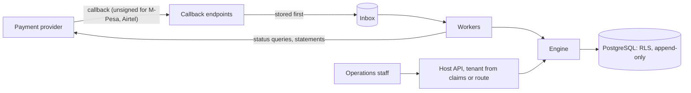

# Threat model and security review

M12's security review for 1.0 (NFR-8), as of 2026-11-23. Report vulnerabilities privately as [SECURITY.md](https://github.com/TrudeauOkech/instalment-flow/blob/main/SECURITY.md)
describes.

## What is protected

| Asset | Why it matters |
|---|---|
| The ledger: journal, payments, allocations, corrections | It is the record of who owes what. Altering it moves money on paper |
| Tenant separation | Several lenders share one database (ADR-007) |
| Provider credentials: Daraja and Airtel keys, M-Pesa initiator password | They can move money or read transaction data |
| Personal data: payer numbers and names in raw callbacks, and customer references | Kenya Data Protection Act 2019. The host is the data controller (R-S2) |
| Availability of callback endpoints | A missed callback is recovered by reconciliation, but only within Pull Transactions' 48 hours |

## Trust boundaries

1. **Provider to callback endpoints:** the internet. The only proof of origin is the path secret, the source address and,
   for providers that sign, the signature.
2. **Host API to the engine:** the host authenticates its callers. The engine trusts the tenant it is given
   (`ITenantContext`).
3. **Application to the database:** the application role cannot bypass row-level security, update facts or truncate.
   The owner role runs migrations only.
4. **Library to the provider APIs:** TLS, OAuth tokens and per-tenant credentials from the host's secret store.

## Threats (STRIDE)

| Threat | Example | Controls | Status |
|---|---|---|---|
| **Spoofing:** forged payment callback | An attacker posts a fake M-Pesa confirmation to credit a loan | Path secret (constant-time comparison); source-network allowlist per provider; reconciliation flags payments missing at the provider (`MissingAtProvider`); **`ConfirmByStatementAbove`** holds large callback payments until a statement confirms them; Airtel callbacks are confirmed by enquiry before anything is recorded (M11) | Mitigated. See F1 |
| Spoofing: another tenant's API caller | A user of lender A acts on lender B | No tenant-less engine; `ITenantContext` from claims; route-based tenants must be authorised by the host | Host responsibility, documented |
| **Tampering:** editing the ledger | A direct `UPDATE ledger_entries` | Append-only triggers (even for the owner), a deferred balance check, no UPDATE or DELETE grant for the application role, `Verify` | Mitigated (M7) |
| Tampering: replayed or duplicated callbacks | The same receipt posted twice | Inbox stores each deduplication key once; the core's source uniqueness (I-3); idempotency keys | Mitigated (M8) |
| Tampering: redirecting a provider account | Mapping a paybill to another tenant | One tenant per account (unique); the mapping API is the host's to protect | Partly. See F4 |
| **Repudiation** | "We never received that payment" | Inbox keeps raw payloads; journal with source references; payment trace | Mitigated |
| **Information disclosure:** cross-tenant reads | A missing filter or a pooled connection leaking the tenant | RLS with `FORCE` and transaction-scoped settings; composite tenant keys; cross-tenant tests | Mitigated (M7, M8) |
| Information disclosure: personal data in telemetry or logs | Payer numbers in spans | Attributes carry no personal data (tested); the core does not log; workers log only the worker name | Mitigated (M12) |
| Information disclosure: raw payloads at rest | The inbox holds callbacks of every tenant | Optional `IPayloadProtector`; database access control | Host choice. See F5 |
| Information disclosure: secrets | Keys in logs or exceptions | `ProviderCredentials` never prints values; secrets are fetched per call from the host's store; samples redact tokens | Mitigated |
| Information disclosure: reference probing | Validation answers reveal which references exist | Only for tenants that opt in, behind the path secret | Accepted. See F3 |
| **Denial of service:** flooding callback endpoints | Large or many posts | Body limit (413) before reading; size and depth limits in adapters; work deferred to the inbox | Partly: add the host's rate limiter |
| DoS: lost callbacks | The endpoint is down | Reconciliation ingests missing payments (MissingInEngine); health checks report reconciliation age | Mitigated (M8) |
| **Elevation of privilege:** simulator in a real environment | Unauthenticated endpoints that create payments | Refused outside `Development` unless explicitly allowed | Mitigated. See F2 |
| Elevation: SQL injection | — | All values are parameterised; interpolated SQL uses only constant schema and table names; role names are quoted | Mitigated (reviewed) |
| Elevation: vulnerable dependencies | — | Core has no dependencies; `dotnet list package --vulnerable` clean; Dependabot and CodeQL | Mitigated |

## Findings of this review

| ID | Severity | Finding | Resolution |
|---|---|---|---|
| F1 | Medium | M-Pesa callbacks are unsigned. With the path secret and a reachable endpoint, a forged confirmation records a payment. Doc 07's `RequireVerificationAbove` had not been built, the allowlist is optional, and behind a proxy it sees the proxy's address | **Fixed:** `PaymentsBuilder.ConfirmByStatementAbove(provider, amount)` holds larger callback payments until reconciliation sees the same transaction and amount on the statement. A warning is logged at start-up when a provider without authenticated callbacks has no allowed networks outside Development. Proxies are documented below |
| F2 | Medium | Simulator endpoints were refused only in `Production`. A Staging environment on real data would accept unauthenticated payments | **Fixed:** refused outside `Development` unless `allowOutsideDevelopment` |
| F3 | Low | For tenants refusing unknown references, validation answers reveal whether a reference exists | **Accepted:** opt-in, behind the path secret. Prefer accepting (the default) |
| F4 | Low–Medium | Changes to provider-account routing are not audited by the library (doc 07 R-I10 assumed they would be) | **Documented:** call `Routing.MapAsync` and `RemoveAsync` only from an audited administrative path. A routing audit trail is a post-1.0 candidate |
| F5 | Info | The inbox is shared by tenants and holds raw payloads with personal data | **Documented:** configure `IPayloadProtector`; restrict database access; set a retention policy |
| F6 | Info | `ProblemDetails.Detail` carries the engine's message, which can name payment sources and amounts | **Accepted:** only the caller's own tenant's data reaches it. Hosts can replace the handler |

No high-severity findings remain open.

## Hardening checklist for hosts

- Use a long random path secret (`Callbacks.PathSecret`, at least 16 characters; 32 or more recommended), keep it in
  your secret store, and rotate it with the provider's callback registration.
- Set `Callbacks.AllowedNetworks` for every provider whose callbacks are not signed: M-Pesa and Airtel. Use the
  ranges the provider publishes. Behind a reverse proxy or load balancer, configure ASP.NET Core forwarded headers
  (`UseForwardedHeaders` with known proxies). Otherwise the allowlist sees the proxy's address.
- Use `ConfirmByStatementAbove` for M-Pesa, at an amount that suits your book. Run reconciliation every hour
  (`Workers.ReconcileAccounts`), well inside the 48-hour Pull window.
- Add a rate limiter (`Microsoft.AspNetCore.RateLimiting`) in front of callback endpoints.
- Give the application database role no `BYPASSRLS`. Run migrations as the owner role only, never from the application.
- Configure `IPayloadProtector` (Data Protection API) and a retention policy for the inbox.
- Authorise the caller for the tenant when using `RouteTenantContext`.
- Alert on `instalmentflow.verify.violations > 0` and on failed inbox entries ([observability](../observability.md)).
